<p align="center">
  <picture>
    <source media="(prefers-color-scheme: dark)" srcset="docs/logo-dark.png">
    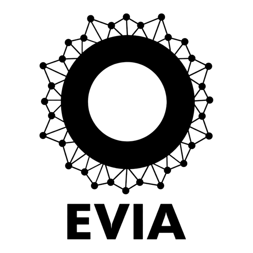
  </picture>
</p>

<h1 align="center">EVIA Paradigma</h1>

<p align="center">
  Visual block programming in Java Swing — with classes, a Vim-powered editor and C / C++ / Python / Java / Kotlin code generation, and Android apps.
  <br><br>
  <a href="https://github.com/sbrutyan01/EVIA-Paradigma/actions/workflows/build.yml"></a>
  <a href="https://github.com/sbrutyan01/EVIA-Paradigma/releases/latest"></a>
  <a href="LICENSE"></a>
  <a href="https://sbrutyan01.github.io/EVIA-Paradigma/"></a>
  <br><br>
  <b><a href="https://sbrutyan01.github.io/EVIA-Paradigma/">Website</a></b> ·
  <a href="https://github.com/sbrutyan01/EVIA-Paradigma/releases/latest">Download</a> ·
  <a href="#tutorial">Tutorial</a>
  <br>
  Tutorial in other languages: <a href="docs/tutorial/TUTORIAL.ru.md">Русский</a> ·
  <a href="docs/tutorial/TUTORIAL.hy.md">Հայերեն</a> ·
  <a href="docs/tutorial/TUTORIAL.de.md">Deutsch</a> ·
  <a href="docs/tutorial/TUTORIAL.zh-CN.md">简体中文</a> ·
  <a href="docs/tutorial/TUTORIAL.zh-TW.md">繁體中文</a> ·
  <a href="docs/tutorial/TUTORIAL.ja.md">日本語</a> · Website:
  <a href="https://sbrutyan01.github.io/EVIA-Paradigma/">English</a> ·
  <a href="https://sbrutyan01.github.io/EVIA-Paradigma/ru/">Русский</a> ·
  <a href="https://sbrutyan01.github.io/EVIA-Paradigma/hy/">Հայերեն</a> ·
  <a href="https://sbrutyan01.github.io/EVIA-Paradigma/de/">Deutsch</a> ·
  <a href="https://sbrutyan01.github.io/EVIA-Paradigma/zh-CN/">简体中文</a> ·
  <a href="https://sbrutyan01.github.io/EVIA-Paradigma/zh-TW/">繁體中文</a> ·
  <a href="https://sbrutyan01.github.io/EVIA-Paradigma/ja/">日本語</a>
</p>

Drag blocks onto a canvas, wire them together, zoom with the mouse wheel, run the program. Define **classes** with
fields, a constructor and methods, share them between programs as **modules**, keep your work
in **project folders** under **Git/GitHub**, edit everything with **Vim**, and turn the
program into a single **C** (C99, C11, C17) or **C++** (C++98 to C++20) file built with **Clang 23** or **GCC**,
or a **Python**, **Java** or **Kotlin** file, with structured or goto control flow and safe or fast values. **Android**
turns it into a phone app (Kotlin) that EVIA Paradigma builds and installs over USB, no Android Studio needed.
**[EVIA Paradigma Native](https://github.com/sbrutyan01/EVIA-Paradigma-Native)**, a project of its own forked from
this one, skips languages altogether: its own compiler turns the blocks straight
into a Linux x86-64 executable, with no compiler, assembler or linker on the computer. The same diagrams program **Arduino and ESP32 boards**:
pin, PWM, analog and time blocks become an Arduino sketch (Uno, Nano, Mega 2560, Leonardo, Micro, Pro Mini; ESP32,
-S2, -S3, -C3, -C6, -H2), bare-metal **AVR C** or bare-metal **PIC32 C** (nine PIC32MX chips) that drive the chip's
registers directly, with **UART, SPI and I2C** blocks, and **Run** simulates the board on your computer. They also become
hardware for **FPGAs**: **SystemVerilog**, **Verilog-2001** or **VHDL** for Xilinx **Artix-7** (Digilent Nexys A7, Arty A7, Basys 3)
and Cologne Chip **GateMate** boards, built with Vivado or the open-source tools. Java Swing with the [FlatLaf](https://github.com/JFormDesigner/FlatLaf) IntelliJ look (light and dark); a Maven project for NetBeans and Java 25.

<p align="center"></p>

**Contents:** [Download](#download) · [Tutorial](#tutorial) · [Building from source](#building-from-source) ·
[Blocks](#blocks) · [Classes](#classes-and-objects) · [Zoom](#zoom) · [Menus](#menus) · [Projects and GitHub](#projects-and-github) ·
[Vim](#vim) · [C and C++](#c-and-c-code-generation) · [Arduino and ESP32](#arduino-and-esp32-boards) · [FPGA](#fpga-artix-7-and-gatemate) · [Command line](#command-line) · [CI](#continuous-integration) · [Screenshots](#screenshots)

## Download

Get the installer for your system from **[evia.am](https://evia.am/)** or the
[latest release](https://github.com/sbrutyan01/EVIA-Paradigma/releases/latest). From 0.9.0 they are **online installers**:
small (the application and its own Java runtime, so Java doesn't need to be installed), and on the first start the
application asks which toolchains to fetch for your boards. They come from the EVIA package server
([evia.am/packages](https://evia.am/packages/index.json)) and stay up to date from inside the application,
**Settings → Packages and Updates…**, without uninstalling or installing anything again; the application updates
itself the same way.

| System | File | Notes |
|---|---|---|
| Windows 10 / 11 (x64) | `EVIA-Paradigma-0.12.1-windows-x64.exe` | Start menu entry, optional desktop shortcut, `.evia` file association, and `evia.exe` for the command line. The installer isn't code-signed yet: on the SmartScreen warning click **More info → Run anyway** |
| macOS, Apple Silicon | `EVIA-Paradigma-0.12.1-macos-arm64.dmg` | Drag **EVIA Paradigma** to Applications. The app isn't notarized by Apple yet: if macOS won't open it, go to **System Settings → Privacy & Security** and click **Open Anyway** |
| macOS, Intel | `EVIA-Paradigma-0.12.1-macos-x64.dmg` | Same as above |
| Ubuntu 22.04+ / Debian 12+ (amd64) | `evia-paradigma_0.12.1_amd64.deb` | `sudo apt install ./evia-paradigma_0.12.1_amd64.deb`. Installs to `/opt/evia-paradigma` with a menu entry and the `evia-paradigma` and `evia` commands |
| Any Linux (x86-64) | `EVIA-Paradigma-0.12.1-x86_64.AppImage` | Nothing to install: `chmod +x EVIA-Paradigma-0.12.1-x86_64.AppImage` and run it. No root and no package manager, so it suits Fedora, Arch, openSUSE or a live system |
| Any OS with Java 25 | `evia-paradigma-0.12.1.jar` | `java -jar evia-paradigma-0.12.1.jar`. It carries the tutorial PDFs in seven languages, which is most of its size |

### Release 0.12.1

[EVIA Paradigma v0.12.1](https://github.com/sbrutyan01/EVIA-Paradigma/releases/tag/v0.12.1) ([release notes](docs/release-notes/v0.12.1.md)):
0.12.0 with the `evia` command in every installer: `/usr/bin/evia` from the .deb, `evia` in the macOS app
(`/Applications/EVIA Paradigma.app/Contents/MacOS/evia`), `evia.exe` on Windows as before.

### Release 0.12.0

[EVIA Paradigma v0.12.0](https://github.com/sbrutyan01/EVIA-Paradigma/releases/tag/v0.12.0) ([release notes](docs/release-notes/v0.12.0.md)):
the [`evia` command](#the-evia-command): `evia gen app.evia -l python,java,c11 -d out/`, `evia watch`, `evia check`,
`evia langs`, `evia boards`. An update package for 0.9.0 to 0.11.1.

### Release 0.11.1

[EVIA Paradigma v0.11.1](https://github.com/sbrutyan01/EVIA-Paradigma/releases/tag/v0.11.1) ([release notes](docs/release-notes/v0.11.1.md)):
0.11.0 with its macOS installers: the native compiler (`--native`) and the link to
[EVIA Paradigma Native](https://github.com/sbrutyan01/EVIA-Paradigma-Native). An update package for 0.9.0 to 0.10.1.

### Release 0.11.0

[EVIA Paradigma v0.11.0](https://github.com/sbrutyan01/EVIA-Paradigma/releases/tag/v0.11.0) ([release notes](docs/release-notes/v0.11.0.md)):
**native executables** and **EVIA Paradigma Native**. An update package for 0.9.0 to 0.10.1.

- A compiler from the blocks straight to a **Linux x86-64 executable**: no compiler, assembler or linker, about 33 KB,
  identical to the interpreter. `--native program.evia -o program`.
- **[EVIA Paradigma Native](https://github.com/sbrutyan01/EVIA-Paradigma-Native)**, forked from this release as a
  project of its own: no code generation, **Build executable** and **Run executable** instead.

### Release 0.10.1

[EVIA Paradigma v0.10.1](https://github.com/sbrutyan01/EVIA-Paradigma/releases/tag/v0.10.1) ([release notes](docs/release-notes/v0.10.1.md)):
Android examples and the phone's sensors. An update package for 0.9.0 to 0.10.0.

- **Phone Sensor** block: the accelerometer, gyroscope and GPS of an Android phone (`ax = ACCEL_X`, `lat = LATITUDE` ...);
  Run simulates them. **Delay** and **Millis** in Java, Kotlin and Android.
- **File → Open Example → Android Phones**: *Hello, world*, *GPS viewer* and *Motion tester*.

### Release 0.10.0

[EVIA Paradigma v0.10.0](https://github.com/sbrutyan01/EVIA-Paradigma/releases/tag/v0.10.0) ([release notes](docs/release-notes/v0.10.0.md)):
**Java, Kotlin and Android**. An update package for 0.9.0 to 0.9.5.

- **Java** and **Kotlin**: two more languages for this computer. **Compile & Run** in the code window builds and runs
  them with the JDK and kotlinc (**Settings → Java and Kotlin**; **Get** downloads Eclipse Temurin 25 and Kotlin
  2.4.21, also packages of the EVIA server). Every example matches the interpreter in both flows and both value modes.
- **Android**: the program becomes a phone app (Kotlin) with Print on the screen and Input in a text field. **Build**
  makes the APK in seconds without Gradle; **Install on Phone** installs it with adb and starts it. **Settings →
  Android → Get Android SDK…** downloads the SDK from Google after you accept Google's licence. The folder is also an
  Android Studio project. `--android program.evia DIR --install` on the command line.

### Release 0.9.5

[EVIA Paradigma v0.9.5](https://github.com/sbrutyan01/EVIA-Paradigma/releases/tag/v0.9.5) ([release notes](docs/release-notes/v0.9.5.md)):
two more boards. An update package for 0.9.0 to 0.9.4.

- **chipKIT Pro MX7** (PIC32 C, PIC32MX795F512L): LD1 on RG12 as `LED_BUILTIN`, Print on the USB-UART (UART1), and
  MQTT over its Ethernet port (LAN8720 PHY). `--board chipkit-pro-mx7`.
- **32F429IDISCOVERY** (STM32 C and Arduino, STM32F429ZI): 168 MHz, 2 MB flash, the green LED LD3 on PG13, Print on
  the ST-LINK's serial port (USART1). `--board disco-f429zi`.

### Release 0.9.4

[EVIA Paradigma v0.9.4](https://github.com/sbrutyan01/EVIA-Paradigma/releases/tag/v0.9.4) ([release notes](docs/release-notes/v0.9.4.md)):
PIC32 upload with Microchip's **ipecmd** (MPLAB IPE) for boards pic32prog cannot program, such as the **PIC32MX
Ethernet Starter Kit II**. An update package for 0.9.0 to 0.9.3.

- **Settings → PIC32 → Programmer**: pic32prog, or ipecmd for the starter kit's on-board programmer (PKOB), PICkit
  3/4/5, ICD 4/5 or Snap; `{chip}` in the upload command is the chosen chip.
- **Get MPLAB IPE…** installs IPE alone from the MPLAB X v6.20 installer you download at microchip.com (Microchip's
  licence does not allow passing IPE on), after checking it is Microchip's file.

### Release 0.9.3

[EVIA Paradigma v0.9.3](https://github.com/sbrutyan01/EVIA-Paradigma/releases/tag/v0.9.3) ([release notes](docs/release-notes/v0.9.3.md)):
the Linux build systems as packages. An update package: 0.9.0 to 0.9.2 take it from **Settings → Packages and Updates…**.

- **Buildroot** 2026.02.3, **Yocto** 5.0.21 (Poky and meta-raspberrypi) and **OpenWrt** 25.12.6 (the sources, and on
  x86-64 the Image Builders for the BeagleBone Black and Raspberry Pi 5) in the package panel, group *Linux images*,
  and from **Get Sources…** in the Linux Images window. Linux only (x64 and ARM64).
- `build.sh` takes the sources from the installed package, and otherwise downloads the same pinned files and checks
  their SHA-256, instead of cloning a branch. Yocto is now pinned to the 5.0.21 release.

### Release 0.9.2

[EVIA Paradigma v0.9.2](https://github.com/sbrutyan01/EVIA-Paradigma/releases/tag/v0.9.2) ([release notes](docs/release-notes/v0.9.2.md)):
a **Linux** menu, next to Git, that builds a custom Linux image for a **BeagleBone Black** or a **Raspberry Pi 5** and
writes it to an SD card. An update package: 0.9.0 and 0.9.1 take it from **Settings → Packages and Updates…**.

| Build system | Version | BeagleBone Black | Raspberry Pi 5 |
|---|---|---|---|
| Buildroot | 2026.02.3 (LTS) | `beaglebone_defconfig` | `raspberrypi5_defconfig` |
| Yocto (Poky) | 5.0 Scarthgap (LTS) | `beaglebone-yocto` | `raspberrypi5` (meta-raspberrypi) |
| OpenWrt, Image Builder or from source | 25.12.6 | `omap/generic`, `ti_am335x-bone-black` | `bcm27xx/bcm2712`, `rpi-5` |

- **Linux → New Linux Image…**: the build system, the board, a folder, the host name, a root password, an SSH server,
  Python 3, LuCI (OpenWrt) and more packages. **Build Image** downloads the sources once, applies the choices and
  builds, with the output in the window; **Menuconfig…** opens the build system's own menu in a terminal.
- **Write to SD Card…** lists only SD cards and USB drives (never a disk this computer runs from), asks twice, and
  writes `.img`, `.wic`, `.gz`, `.bz2`, `.xz` or `.zst` images as root through pkexec.
- **Check This Computer** lists the missing build tools with the `apt` or `dnf` line that installs them, the free
  disk space and, for Yocto, Ubuntu's AppArmor setting that blocks BitBake.
- Every image is a folder with `evia-linux.json` and a `build.sh` that runs on its own: `./build.sh all`. The root
  password stays in `secrets/` (owner-only); the image gets only its SHA-512 hash. Command line:
  `java -jar evia-paradigma.jar --linux ~/evia-linux/pi --system yocto --board rpi5`.

### Release 0.9.1

[EVIA Paradigma v0.9.1](https://github.com/sbrutyan01/EVIA-Paradigma/releases/tag/v0.9.1) ([release notes](docs/release-notes/v0.9.1.md)):
a Terminal window, and pic32prog as a package. An update package: a 0.9.0 installation takes it from
**Settings → Packages and Updates…** without reinstalling.

- **Terminal** (toolbar, or Help → Terminal): a real terminal, one tab per session, on a board's **serial port** (port
  with Scan, baud rate, what Enter sends, local echo) or on another computer over **SSH** (password or key; a new
  host key is shown for you to accept and remembered in `~/.ssh/known_hosts`). Colours, cursor keys and full-screen
  programs work, so `top` or `vim` on a Raspberry Pi do too.
- **pic32prog package**: the PIC32 uploader (PICkit2, PICkit3 in PICkit2 mode, the chipKIT and Microchip
  bootloaders, FT2232 JTAG) built for Windows, macOS and Linux and served by the EVIA package server. The default
  PIC32 upload command uses it as soon as it is installed (Settings → PIC32 → Get). XC32 still comes from Microchip.

### Release 0.9.0

[EVIA Paradigma v0.9.0](https://github.com/sbrutyan01/EVIA-Paradigma/releases/tag/v0.9.0) ([release notes](docs/release-notes/v0.9.0.md)):
STM32 boards, OpenOCD, online installers and packages from the EVIA server.

- **STM32**: Blue Pill (F103C8), Black Pill (F411CE), Nucleo-F401RE, Nucleo-F411RE and the F4DISCOVERY (F407VG), in two
  ways: **Language → STM32 C** writes bare-metal C for the chip (registers only, no HAL; its own start-up code and
  linker script, built with arm-none-eabi-gcc), and **Language → Arduino** builds a sketch with STMicroelectronics'
  core. **Devices** has both families; **Settings → STM32…** has the board, the tools and the upload command.
- **OpenOCD**: Upload sends either kind of program to the board through an ST-Link (built into the Nucleo and
  Discovery, a separate ST-Link V2 for the Pills). The command is a template in Settings, so st-flash, STM32CubeProgrammer
  or a serial bootloader can take its place.
- **Online installers and packages**: the installers are small; the toolchains (arduino-cli, avr-gcc with avrdude,
  the Arm GNU Toolchain, OpenOCD, the OSS CAD Suite) are packages of the EVIA server, picked on the first start and
  updated in place from **Settings → Packages and Updates…**. Every file is checked against its SHA-256 before it is used.
- **The application updates itself**: a newer version is a package too. It installs next to the one you have and
  starts the next time (or at once with **Restart Now**); nothing is uninstalled. A version that would not start is
  skipped and the one you had runs.
- On the command line: `--packages`, `--install ID… | updates`, `--remove ID`, and `--lang stm32 --board nucleo-f401re`.

### Release 0.8.0

[EVIA Paradigma v0.8.0](https://github.com/sbrutyan01/EVIA-Paradigma/releases/tag/v0.8.0) ([release notes](docs/release-notes/v0.8.0.md)):
the toolchains come with the installers, XC32 installs from inside the application, and Settings and Devices are menus.

- **Toolchains in the installers**: avr-gcc with avr-libc and avrdude, and the OSS CAD Suite (yosys, nextpnr, gmpack,
  openFPGALoader), in `toolchains/` inside the application. Bare-metal AVR C and the FPGA flows work with nothing to
  set up; a path set in Settings still wins. `evia-paradigma --version` says which tools are used.
- **Get XC32**: Microchip's licence does not allow passing XC32 on, so **Settings → PIC32… → Get XC32…** downloads
  Microchip's free XC32 4.35 installer from microchip.com, checks it against Microchip's file, asks you to accept
  Microchip's licence and runs Microchip's installer (with your administrator password). An XC32 already installed
  in Microchip's usual folder is found by itself.
- **Settings** and **Devices** menus between Git and Help. Devices lists every family with its boards: choosing one
  sets the language and board together.

<p align="center">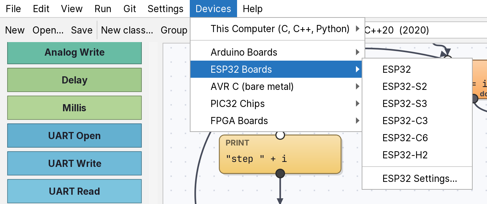</p>

### Release 0.7.1

[EVIA Paradigma v0.7.1](https://github.com/sbrutyan01/EVIA-Paradigma/releases/tag/v0.7.1) ([release notes](docs/release-notes/v0.7.1.md)):
a generic Linux build, and the board modules written up on the site.

- **AppImage for any Linux, x86-64**: one executable file with the Java runtime inside it. Nothing to install, no root
  and no package manager, so it covers Fedora, Arch, openSUSE and live systems that the `.deb` does not. It is built
  from the same application image as the `.deb`, by `packaging/appimage.sh`, and both are smoke-tested before release.
- **The site documents the modules a board program can use** — UART, SPI, I2C and MQTT, with what each one does and
  which targets carry it — in place of the canvas panning section, in all seven languages.

### Release 0.7.0

[EVIA Paradigma v0.7.0](https://github.com/sbrutyan01/EVIA-Paradigma/releases/tag/v0.7.0) ([release notes](docs/release-notes/v0.7.0.md)):
Settings in the File menu, one page per device family.

- **File → Settings ▸** General, C/C++/Python, Arduino Boards, ESP32 Boards, AVR C, PIC32, FPGA Boards: each entry
  opens the Settings window at its own tab. Arduino and ESP32 have separate pages and board lists; the PIC32 chip and
  the FPGA board can be chosen there too; one serial port list with **Scan** is shared by every board page.
- **File → Open Example** has **Arduino Boards**, **ESP32 Boards** and **PIC32 Boards** (and **FPGA Boards**); each
  shows the examples its boards can build and sets the language and board when one is opened.
- **Settings…** in the code window opens the page for the language shown; Settings has left the Edit menu.

<p align="center">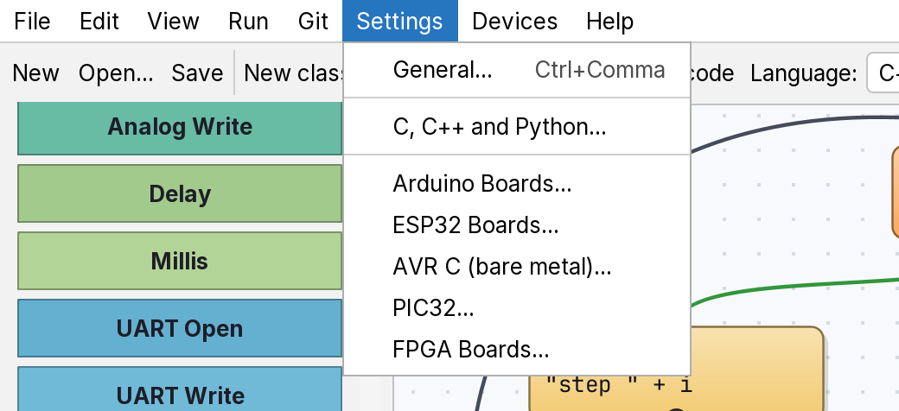
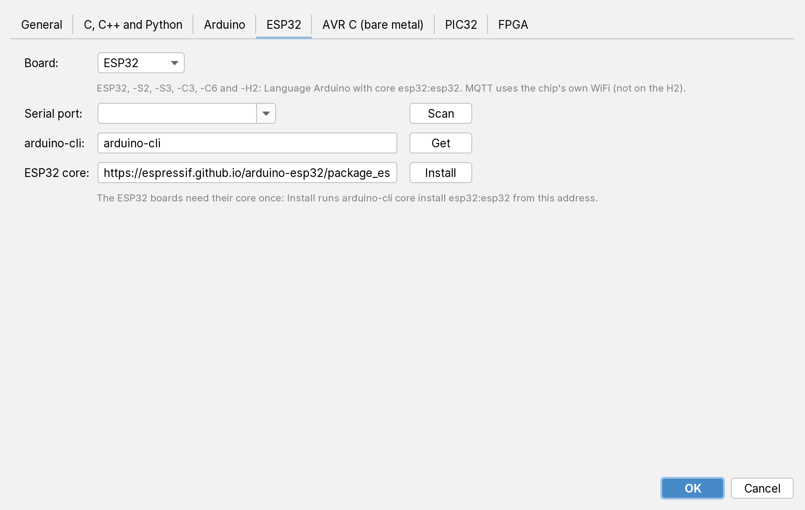</p>

### Release 0.6.9

[EVIA Paradigma v0.6.9](https://github.com/sbrutyan01/EVIA-Paradigma/releases/tag/v0.6.9) ([release notes](docs/release-notes/v0.6.9.md)):
**Python 3** joins the languages.

- **Language → Python 3** (`--lang python`) turns a block program into one `.py` file that runs on Python 3.8 or
  newer with nothing to install. Classes become Python classes, program variables become module globals, and every
  Print, Input and error message is the interpreter's own, so a program behaves the same in the editor and in Python.
- **Run** in the code window starts it with the Python from **Settings → Python** (found by itself: `py` on Windows,
  `python3` elsewhere; **Detect** and **Check** next to it).
- Python has no `goto`, so *Structured* flow writes `if`/`else` and `while` loops, and *Goto* flow (or wiring that
  isn't block-structured) becomes a small state machine with one branch per block. *Safe* and *Fast* values both work.
- Tested like the C and C++ targets: every example and test program, both flows, both value modes, identical to the
  interpreter in output, errors and exit code; number text checked against Java on 200,000 values.

### Release 0.6.8

[EVIA Paradigma v0.6.8](https://github.com/sbrutyan01/EVIA-Paradigma/releases/tag/v0.6.8) ([release notes](docs/release-notes/v0.6.8.md)):
choosing the board's serial port from a list, and installing the ESP32 core from Settings.

- **Settings → Serial port** is a drop-down of the ports there are now, with what is on each one
  (`/dev/ttyUSB0 - Silicon Labs CP2102`, `COM5 - USB-SERIAL CH340`). **Scan** looks again after a board is plugged in;
  the list is also filled when Settings opens. A port can still be typed by hand, and a saved port that is not
  connected stays chosen. No serial library is involved: Linux and macOS list `/dev`, Windows reads the registry.
- **Settings → ESP32 core** holds Espressif's board package address, with **Install** next to it: it runs
  `arduino-cli core update-index` and `core install esp32:esp32` from that address and shows arduino-cli's output as
  it goes. Change the address to use a mirror or Espressif's development index.

### Release 0.6.7

[EVIA Paradigma v0.6.7](https://github.com/sbrutyan01/EVIA-Paradigma/releases/tag/v0.6.7) ([release notes](docs/release-notes/v0.6.7.md)):
the interface itself in Russian and Armenian, and MQTT over a PIC32's own Ethernet port.

- **Settings → Interface language**: English, Русский or Հայերեն. The menus, the toolbar, the palette, the buttons,
  the dialogs and the names on the blocks (`СТАРТ`, `ՍԿԻԶԲ`) all follow; the change takes effect when the application
  starts again.
- The **generated code and the compilers' messages stay in English**, so a program looks the same whoever opens it.
- The translations are plain tab-separated files, [`i18n/ru.tsv`](src/main/resources/evia/paradigma/i18n/ru.tsv) and
  [`hy.tsv`](src/main/resources/evia/paradigma/i18n/hy.tsv): English on the left, the translation on the right. A line
  without a translation simply stays English, so adding to them cannot break the application.
- [`scripts/i18n/collect.py`](scripts/i18n/collect.py) lists what the interface asks for and what is still missing,
  and the checks fail when a language falls behind — all 171 strings are translated in both.
- [`scripts/publish-gitlab.sh`](scripts/publish-gitlab.sh) publishes a release to a self-hosted GitLab as well:
  `GITLAB_TOKEN=... scripts/publish-gitlab.sh v0.6.7` pushes `main` and the tag, then creates the release with
  that version's notes file as its description. The token is read from the environment and never written down.
- [`scripts/mirror-to-gitlab.sh`](scripts/mirror-to-gitlab.sh) copies the whole repository there instead of one
  release: every branch, every tag, and all 13 releases with their installers fetched from GitHub and attached, so
  the GitLab can serve the downloads itself. Run it where both are reachable; `--prune` also removes refs that exist
  only on the GitLab.
- The website's download links are no longer tied to GitHub: `DOWNLOAD_BASE=https://host/path python3
  scripts/build-site.py` points all three at another server, in every language, leaving the file names as they are.
  Without it they go to that version's GitHub release, as before.
- **MQTT over the chip's own Ethernet port** (experimental), on the MX695F512L, the MX795F512L and the Ethernet
  Starter Kit II: **Settings → PIC32 MQTT over → Ethernet, Harmony TCP/IP**, or `--net ethernet`. The four transport
  functions change and nothing above them does, so the blocks and the diagram are untouched; the generated file
  becomes an application for an **MPLAB X Harmony project** — `app_run()` instead of `main()`, the project's own
  device configuration and clock, `SYS_Tasks()` inside every wait, and DHCP for the address.
  [How to set the project up](#mqtt-over-the-chips-own-ethernet-port-mx695--mx795-experimental). It compiles only
  against stub headers here, never against real Harmony or a board, so the WiFi module remains the tested path.
- **Fixed:** *PIC32 MQTT over: Ethernet* was turning every PIC32 program into a Harmony application, even one with
  no MQTT in it, which `xc32-gcc` then could not compile on its own. Harmony now needs the setting **and** an
  *MQTT Connect* block in the program.

| File | Platform | Size |
|---|---|---|
| `EVIA-Paradigma-0.6.7-windows-x64.exe` | Windows 10/11 x64 | 44.6 MB |
| `evia-paradigma_0.6.7_amd64.deb` | Ubuntu/Debian amd64 | 39.2 MB |
| `evia-paradigma-0.6.7.jar` | Any OS with Java 25 | 17.1 MB |
| `LICENSE` | MIT license | 1 KB |

macOS installers are not part of this release; they will return in a later one.

### Release 0.6.6

[EVIA Paradigma v0.6.6](https://github.com/sbrutyan01/EVIA-Paradigma/releases/tag/v0.6.6) ([release notes](docs/release-notes/v0.6.6.md)):
the PIC32 Ethernet Starter Kit II, and an MQTT example for it.

- **The starter kit is a board of its own** in the **Board** list: PIC32 Ethernet Starter Kit II (MX795F512L), with
  LED1 on RD0, so `LED_BUILTIN` and the generated pin names match the kit instead of a chipKIT board.
- **New example** *MQTT on the PIC32 Ethernet Starter Kit II* (**File → Open Example → Arduino and ESP32 Boards**):
  SW1 (RD6) goes to the broker, LED1 (RD0) follows what comes back and LED2 (RD1) follows the button directly, so the
  round trip through the broker is visible. Both MQTT examples are in that menu now.
- **Checks:** the PIC32 output of every example, for the boards of the three chip families and both flows, compiles
  against Microchip's real device headers (180 of 180); the board checks skip programs whose pin names belong to
  another chip, and the MQTT blocks say so on the ESP32-H2, which has no WiFi.
- The kit's **Ethernet port is still not used**: MQTT goes through the WiFi module on UART2 (RF4 / RF5 on the
  expansion connector), as on the other PIC32 chips.

| File | Platform | Size |
|---|---|---|
| `EVIA-Paradigma-0.6.6-windows-x64.exe` | Windows 10/11 x64 | 44.6 MB |
| `evia-paradigma_0.6.6_amd64.deb` | Ubuntu/Debian amd64 | 39.1 MB |
| `evia-paradigma-0.6.6.jar` | Any OS with Java 25 | 17.1 MB |
| `LICENSE` | MIT license | 1 KB |

macOS installers are not part of this release; they will return in a later one.

### Release 0.6.5

[EVIA Paradigma v0.6.5](https://github.com/sbrutyan01/EVIA-Paradigma/releases/tag/v0.6.5) ([release notes](docs/release-notes/v0.6.5.md)):
MQTT blocks, and Settings fetches the outside tools.

- **Five MQTT blocks** (Connect, Publish, Subscribe, Has Message, Read) in the *Board* group: on a PIC32MX with a
  WiFi module on UART2, on an ESP32 with its own WiFi, and in **Run** against a broker on your computer. See
  [MQTT](#mqtt-send-the-numbers-somewhere).
- **Two examples** under **File → Open Example → Arduino and ESP32 Boards**: *MQTT: publish a value, read a command
  back*, and *MQTT on the PIC32 Ethernet Starter Kit II*, where SW1 goes to the broker and LED1 follows what comes
  back. The starter kit is a board of its own in the **Board** list (MX795F512L, LED1 on RD0).
- **Settings fetches the tools:** arduino-cli, avr-gcc and the OSS CAD Suite are downloaded into EVIA Paradigma's own
  folder; XC32 opens Microchip's page, because its licence does not allow passing the compiler on.
- **Tested** by compiling the generated MQTT client and running it against a real broker (`scripts/check-mqtt.sh`),
  compiling the ESP32 sketch as C++, and compiling the PIC32 output against Microchip's headers (180 of 180). No WiFi
  module, ESP32 or PIC32 chip was part of that; Ethernet MQTT on the MX695/795 chips is not supported yet.

| File | Platform | Size |
|---|---|---|
| `EVIA-Paradigma-0.6.5-windows-x64.exe` | Windows 10/11 x64 | 44.6 MB |
| `evia-paradigma_0.6.5_amd64.deb` | Ubuntu/Debian amd64 | 39.1 MB |
| `evia-paradigma-0.6.5.jar` | Any OS with Java 25 | 17.1 MB |
| `LICENSE` | MIT license | 1 KB |

macOS installers are not part of this release; they will return in a later one.

### Release 0.6.1

[EVIA Paradigma v0.6.1](https://github.com/sbrutyan01/EVIA-Paradigma/releases/tag/v0.6.1) ([release notes](docs/release-notes/v0.6.1.md)):
the middle mouse button moves the canvas.

- **Press the wheel and drag** over a diagram to move the canvas: on empty space or on a block, in the main program and
  in a class window, at every zoom. Blocks are neither moved nor selected by it, and the saved file does not change.
- The guide's shortcut table (English, Russian, Armenian) and [Zoom](#zoom) list the new gesture.
- **Tested** by the zoom checks on a real window, which now drag with the middle button on the canvas and on a block and
  compare the view position.

| File | Platform | Size |
|---|---|---|
| `EVIA-Paradigma-0.6.1-windows-x64.exe` | Windows 10/11 x64 | 35.4 MB |
| `evia-paradigma_0.6.1_amd64.deb` | Ubuntu/Debian amd64 | 30.3 MB |
| `evia-paradigma-0.6.1.jar` | Any OS with Java 25 | 7.9 MB |
| `LICENSE` | MIT license | 1 KB |

macOS installers are not part of this release; they will return in a later one.

### Release 0.6.0

[EVIA Paradigma v0.6.0](https://github.com/sbrutyan01/EVIA-Paradigma/releases/tag/v0.6.0) ([release notes](docs/release-notes/v0.6.0.md)): FPGAs. SystemVerilog, Verilog-2001 and VHDL for Artix-7 and GateMate boards.

- **Three new languages** (`--lang sv|verilog|vhdl`): the flowchart becomes a state machine, one state per block, with
  32-bit whole-number variables, exact `Delay`, `Millis`, PWM, a serial port for Print and the UART blocks, and a
  shared divider. The three outputs describe the same circuit. See [FPGA](#fpga-artix-7-and-gatemate).
- **Six boards:** Digilent Nexys A7-100T, Arty A7-35, Arty A7-100 and Basys 3 (Artix-7, 100 MHz), Olimex GateMateA1-EVB
  and the Cologne Chip GateMate A1 evaluation board (10 MHz). Pins are named `LED0`, `SW0`, `BTNC`, `JA1` ... on every board
  and in Run; the pin constraints (`.xdc` or `.ccf`) are written into the header of the generated file and next to it by `-o`.
- **Build and Upload** for FPGAs: Artix-7 with Vivado or the open-source openXC7 tools (your choice in Settings), GateMate with
  yosys, nextpnr-himbaechel and gmpack; openFPGALoader loads the bitstream.
- **Six examples** under **File → Open Example → FPGA Boards**; a **tutorial step** on FPGAs (all three languages).
- **Tested** by simulating nine test programs in all three languages (Icarus Verilog, GHDL) against the interpreter, 27 of 27
  equal, and by synthesising every example with yosys; the GateMate designs are placed, routed and packed into bitstreams.
  **Not tested:** Vivado, nextpnr-xilinx and any real board.
- Integer arithmetic in the hardware differs from **Run** in one way (`5 / 2` is 2, not 2.5): see the FPGA section.

| File | Platform | Size |
|---|---|---|
| `EVIA-Paradigma-0.6.0-windows-x64.exe` | Windows 10/11 x64 | 35.4 MB |
| `evia-paradigma_0.6.0_amd64.deb` | Ubuntu/Debian amd64 | 30.3 MB |
| `evia-paradigma-0.6.0.jar` | Any OS with Java 25 | 7.9 MB |
| `LICENSE` | MIT license | 1 KB |

macOS installers are not part of this release; they will return in a later one.

### Release 0.5.0

[EVIA Paradigma v0.5.0](https://github.com/sbrutyan01/EVIA-Paradigma/releases/tag/v0.5.0) ([release notes](docs/release-notes/v0.5.0.md)): PIC32MX chips and the UART, SPI and I2C blocks.

- **UART, SPI and I2C blocks** (UART Open / Write / Read, SPI Open / Transfer, I2C Open / Write / Read) in the *Board*
  group. They work in **Run** (a simulated loopback UART, SPI and an I2C device at address 80), in Arduino sketches
  (Serial, SPI.h, Wire.h) and in bare-metal AVR C (USART, SPI and TWI registers).
- **PIC32 C**: a new language for nine PIC32MX chips, bare-metal C for Microchip's XC32 (no Harmony or plib):
  MX1xx/2xx (150F128B, 250F128B, 270F256B), MX3xx/4xx (320F128H, 340F512H, 440F256H, 460F512L),
  MX5xx/6xx/7xx (695F512L, 795F512L). Clock, pins, PWM, ADC, UART, SPI and I2C are set up through the registers.
- **Tutorial as PDF** in English, Russian and Armenian: **Help → Tutorial (PDF)**, also in [`docs/tutorial`](docs/tutorial) and on the website. It has a new step on the bus blocks and PIC32.
- **Build and Upload** for PIC32: xc32-gcc, xc32-bin2hex and an upload command you choose (pic32prog by default).
  `--lang pic32 --board KEY` on the command line.
- **Tested** against a PC compiler and Microchip's real device headers (144 combinations, `-Werror`), and the bus code of
  the Arduino and AVR outputs in simavr. PIC32 output is **not** yet built with XC32 or run on a chip: see
  [PIC32 notes](#arduino-and-esp32-boards).

| File | Platform | Size |
|---|---|---|
| `EVIA-Paradigma-0.5.0-windows-x64.exe` | Windows 10/11 x64 | 35.3 MB |
| `evia-paradigma_0.5.0_amd64.deb` | Ubuntu/Debian amd64 | 30.1 MB |
| `evia-paradigma-0.5.0.jar` | Any OS with Java 25 | 7.8 MB |
| `LICENSE` | MIT license | 1 KB |

macOS installers are not part of this release; they will return in a later one.

### Release 0.4.1

[EVIA Paradigma v0.4.1](https://github.com/sbrutyan01/EVIA-Paradigma/releases/tag/v0.4.1) ([release notes](docs/release-notes/v0.4.1.md)):
a dark mode, the look and fonts of IntelliJ IDEA, and the guide in Russian and Armenian.

- **Dark mode:** **View → Theme**: *Same as system*, *Light (IntelliJ)* or *Dark (Darcula)*. It changes at once, also in
  the diagram, the code window and the guide, and is remembered.
- **IntelliJ look:** [FlatLaf](https://github.com/JFormDesigner/FlatLaf) themes, **Inter** for the interface and
  **JetBrains Mono** for code and blocks, both bundled, so the app looks the same on Windows, macOS and Linux.
- **Guide in three languages:** **Help → Guide** has an English / Русский / Հայերեն list above the topics.
- The jar now contains FlatLaf and the fonts (2.4 MB); `java -jar` still runs it.
- **Tests:** 416 of 416 programs identical on Linux (Clang 23.1.6, GCC 13.3), 260 of 260 on Windows (llvm-mingw Clang
  23.1.4, WinLibs GCC 16.2), boards 100 passed, application, guide, font, theme and zoom checks passed.

| File | Platform | Size |
|---|---|---|
| `EVIA-Paradigma-0.4.1-windows-x64.exe` | Windows 10/11 x64 | 30.1 MB |
| `EVIA-Paradigma-0.4.1-macos-arm64.dmg` | macOS, Apple Silicon | 31.5 MB |
| `EVIA-Paradigma-0.4.1-macos-x64.dmg` | macOS, Intel | 33.0 MB |
| `evia-paradigma_0.4.1_amd64.deb` | Ubuntu/Debian amd64 | 26.0 MB |
| `evia-paradigma-0.4.1.jar` | Any OS with Java 25 | 2.4 MB |
| `LICENSE` | MIT license | , |

<p align="center">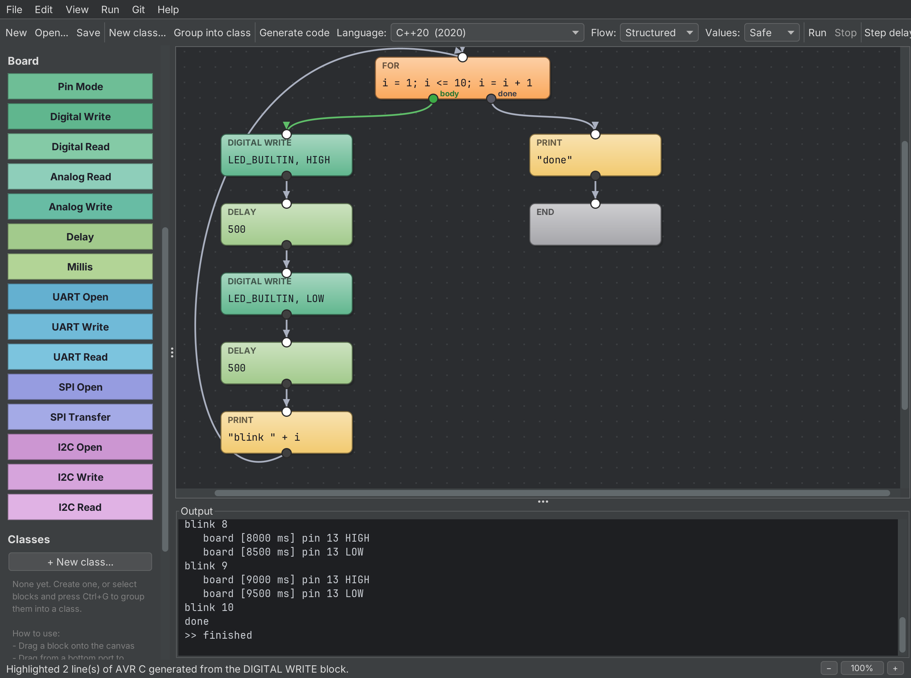</p>

### Release 0.4.0

[EVIA Paradigma v0.4.0](https://github.com/sbrutyan01/EVIA-Paradigma/releases/tag/v0.4.0) ([release notes](docs/release-notes/v0.4.0.md)):
Arduino and ESP32 boards, bare-metal AVR C, board blocks with a simulated Uno, and GCC as a choice next to Clang.

- **Board blocks:** Pin Mode, Digital Write, Digital Read, Analog Read, Analog Write (PWM), Delay, Millis.
- **Arduino sketch** for 12 boards: Arduino Uno, Nano, Mega 2560, Leonardo, Micro, Pro Mini; ESP32, ESP32-S2, -S3, -C3, -C6, -H2.
- **AVR C**: bare metal for the ATmega328P, ATmega2560 and ATmega32U4. avr-gcc and avr-libc only: pins, timers,
  PWM, the ADC and a 115200-baud UART through the registers, with Arduino's pin numbering.
- **Build and Upload** in the code window (arduino-cli, or avr-gcc + avrdude); **Board** list next to the language.
- **Run simulates an Uno**: pin changes in the output, a button and an analog signal, repeatable virtual time.
- **GCC**: Settings → Compiler: Clang or GCC; on Windows **Install GCC…** sets up WinLibs MinGW-w64 GCC (no Visual Studio).
- Examples: **File → Open Example → Arduino Boards** (or **ESP32 Boards**, **PIC32 Boards**) (blink, button, fade, analog meter, Led class, UART, SPI, I2C, and the two MQTT programs).
- [Website](https://sbrutyan01.github.io/EVIA-Paradigma/): light and dark themes (follows the system; **Light / Dark**
  buttons in the header), a bigger logo and name, the board features and this release's test results.

| File | Platform | Size |
|---|---|---|
| `EVIA-Paradigma-0.4.0-windows-x64.exe` | Windows 10/11 x64 | 28.0 MB |
| `EVIA-Paradigma-0.4.0-macos-arm64.dmg` | macOS, Apple Silicon | 28.3 MB |
| `EVIA-Paradigma-0.4.0-macos-x64.dmg` | macOS, Intel | 29.7 MB |
| `evia-paradigma_0.4.0_amd64.deb` | Ubuntu/Debian amd64 | 23.0 MB |
| `evia-paradigma-0.4.0.jar` | Any OS with Java 25 | 0.5 MB |
| `LICENSE` | MIT license | — |

| CI check | Result |
|---|---|
| Board examples as bare-metal AVR C, avr-gcc 14.1, `-Werror`, run in simavr (ATmega328P, ATmega2560, ATmega32U4 × structured/goto) | 30 of 30 identical to the interpreter, LED on the right pin |
| Arduino sketches, arduino-cli with arduino:avr 1.8.8 and esp32:esp32 3.3.12, 12 boards | 70 of 70 built without warnings; the 15 Uno and Mega 2560 builds identical in simavr |
| Every language and mode, Clang 23.1.6 and GCC 13.3 (Linux) | 416 of 416 identical, each |
| C and C++ standards on Windows: llvm-mingw Clang 23.1.4 and WinLibs GCC 16.2, `-static` | 260 of 260 identical, each; no Visual Studio or compiler DLLs |
| Examples, application, Git and zoom checks | All passed |

### Release 0.3.1

[EVIA Paradigma v0.3.1](https://github.com/sbrutyan01/EVIA-Paradigma/releases/tag/v0.3.1) ([release notes](docs/release-notes/v0.3.1.md)):
zoom block diagrams with the mouse wheel, plus the two Windows fixes listed under 0.3.0.

| File | Platform | Size |
|---|---|---|
| `EVIA-Paradigma-0.3.1-windows-x64.exe` | Windows 10/11 x64 | 28.0 MB |
| `EVIA-Paradigma-0.3.1-macos-arm64.dmg` | macOS, Apple Silicon | 28.2 MB |
| `EVIA-Paradigma-0.3.1-macos-x64.dmg` | macOS, Intel | 29.7 MB |
| `evia-paradigma_0.3.1_amd64.deb` | Ubuntu/Debian amd64 | 22.9 MB |
| `evia-paradigma-0.3.1.jar` | Any OS with Java 25 | 0.5 MB |
| `LICENSE` | MIT license | — |

| CI check | Result |
|---|---|
| Mouse-wheel zoom on the real main window (Linux, virtual display) | All passed |
| Every language and mode, Clang 23 (Linux) | 384 of 384 identical to the interpreter |
| Every language and mode, GCC (Linux) | 384 of 384 identical |
| C and C++ standards, llvm-mingw Clang (Windows, no Visual Studio) | 240 of 240 identical |
| Examples, application and Git checks | All passed |
| Installers built for all platforms and attached to the release | Passed |

### Release 0.3.0

[EVIA Paradigma v0.3.0](https://github.com/sbrutyan01/EVIA-Paradigma/releases/tag/v0.3.0) ([release notes](docs/release-notes/v0.3.0.md)):
C99, C11, C17 and C++98 to C++20, structured/goto flow, safe/fast values.

| File | Platform | Size |
|---|---|---|
| `EVIA-Paradigma-0.3.0-windows-x64.exe` | Windows 10/11 x64 | 28.0 MB |
| `EVIA-Paradigma-0.3.0-macos-arm64.dmg` | macOS, Apple Silicon | 28.2 MB |
| `EVIA-Paradigma-0.3.0-macos-x64.dmg` | macOS, Intel | 29.7 MB |
| `evia-paradigma_0.3.0_amd64.deb` | Ubuntu/Debian amd64 | 22.9 MB |
| `evia-paradigma-0.3.0.jar` | Any OS with Java 25 | 0.5 MB |
| `LICENSE` | MIT license | — |

CI ([`build.yml`](.github/workflows/build.yml)): every program in `examples/` and `tests/programs/` in every
language and mode, compiled with `-Wall -Wextra -Wpedantic -Werror` and compared with the interpreter
(stdout, stderr, exit code):

| Where | Compiler | Identical to the interpreter | Refused by fast values¹ | Failed |
|---|---|---|---|---|
| Linux, all 8 languages | Clang 23.1.5 | 384 of 384 | 64 | 0 |
| Linux, all 8 languages | GCC 13.3 | 384 of 384 | 64 | 0 |
| Windows (C99, C17, C++98, C++14, C++20) | llvm-mingw Clang 23.1.4, `-static` | 240 of 240 | 40 | 0 |
| Linux and Windows | examples, application and Git checks (`check-examples.sh`, `check-app.sh`) | passed | — | 0 |

¹ As intended: those programs keep text in variables, which fast values (plain `double`) don't allow.
On Windows the programs need no Visual Studio DLLs.

Release 0.3.1 also has two fixes found by the Windows CI job (they only show with the strict test flags
`-Wpedantic -Werror`, so the published installers work): whole numbers beyond 32 bits are written as `10000000000.0`
(on Windows `long` is 32-bit, and C++98 rejects `long long` literals), and the test scripts ignore `\r\n` line endings.

### Release 0.2.0

[EVIA Paradigma v0.2.0](https://github.com/sbrutyan01/EVIA-Paradigma/releases/tag/v0.2.0) ([release notes](docs/release-notes/v0.2.0.md))

| File | Platform | Size |
|---|---|---|
| `EVIA-Paradigma-0.2.0-windows-x64.exe` | Windows 10/11 x64 | 27.9 MB |
| `EVIA-Paradigma-0.2.0-macos-arm64.dmg` | macOS, Apple Silicon | 28.2 MB |
| `EVIA-Paradigma-0.2.0-macos-x64.dmg` | macOS, Intel | 29.6 MB |
| `evia-paradigma_0.2.0_amd64.deb` | Ubuntu/Debian amd64 | 22.9 MB |
| `evia-paradigma-0.2.0.jar` | Any OS with Java 25 | 0.4 MB |
| `LICENSE` | MIT license | — |

| Check on the release build | Result |
|---|---|
| Every installer starts and runs the built-in example | Passed |
| Examples: interpreter and the Clang 23 build give identical output | Passed |
| Classes, modules, View C++ source, projects and Git (`scripts/check-app.sh`) | Passed |
| Release notes on the release page | Yes |

## Tutorial

*Also as PDF in [English](docs/tutorial/EVIA-Paradigma-Tutorial.en.pdf), [Русский](docs/tutorial/EVIA-Paradigma-Tutorial.ru.pdf), [Հայերեն](docs/tutorial/EVIA-Paradigma-Tutorial.hy.pdf), [Deutsch](docs/tutorial/EVIA-Paradigma-Tutorial.de.pdf), [简体中文](docs/tutorial/EVIA-Paradigma-Tutorial.zh-CN.pdf), [繁體中文](docs/tutorial/EVIA-Paradigma-Tutorial.zh-TW.pdf) and [日本語](docs/tutorial/EVIA-Paradigma-Tutorial.ja.pdf) (also under Help → Tutorial).*

This walk-through builds a small project with a loop and a class, runs it, looks at the C and C++ it becomes,
and puts it under Git. Every picture is the real application (they are regenerated with
[`scripts/take-screenshots.sh`](scripts/take-screenshots.sh)).

### 1. Create a project

**File → New Project…** (Ctrl+Shift+N). Enter a name and a location; keep *Create a Git repository* checked
if git is installed.

<p align="center"></p>

The project opens with a starter program, *Start → Print → End*. The output panel shows that git created
the repository and the first commit.

<p align="center"></p>

### 2. Build a loop

Drag blocks from the palette onto the canvas and connect them: drag from a block's bottom port (dark dot)
to the next block's top port (white dot). Double-click a block to edit its code.

- **Set**: `n = 3`
- **For**: `i = 1; i <= n; i = i + 1`. Its `body` port goes to **Print** `"step " + i`; wire the end of the
  body **back into the For block** to start the next pass. Its `done` port goes to **End**.

Press **Run** (F5). Set *Step delay* to watch the active block move. Turn the mouse wheel over the diagram to [zoom](#zoom) in and out.

<p align="center"></p>

### 3. Create a class

**Edit → New Class…** (or *+ New class…* in the palette), name it `Counter`. The class window has a
**Fields** tab and one tab per method.

**Fields**: add `total` and `calls`, both starting at `0`. Every object gets its own copy.

<p align="center"></p>

**Methods**: rename the first method to `add` with parameter `x` (press **Apply**), then build its body
from **Enter** to **Exit**. Inside a method, fields and parameters are written as `this.name`:

<p align="center"></p>

**+ Constructor** adds `init`, which runs once when an object is created (after the fields get their
initial values). Here it prints `"new counter"`. **+ Method…** adds `show` that prints
`"total = " + this.total + " after " + this.calls + " calls"`.

<p align="center"></p>

### 4. Use the class

The palette now lists `Counter.add(x)` and `Counter.show()`. Drag `Counter.add(x)` into the loop body after
**Print** and `Counter.show()` between `done` and **End**. Double-click a call block to choose the method,
the **object** and the arguments. Give both blocks the object name `c` so they share one object:

<p align="center"></p>

Run it. `c` is created on its first use (so `new counter` is printed then), `add` runs three times,
and `show` prints the total:

<p align="center"></p>

### 5. See the code for any block

Right-click a block → **View source code**. The generated code opens with exactly that block's lines highlighted
(here C++20, the default):

<p align="center"></p>

<p align="center"></p>

**Compile & Run** builds it with Clang and runs it. The compiled program prints the same as the interpreter.
On Windows the app installs the llvm-mingw Clang for you (no Visual Studio needed).

<p align="center"></p>

### 6. Choose C or another C++ standard

Pick a **Language** in the drop-down list (in the code window or the main toolbar); the code is generated again
at once, and the same block stays highlighted. **Flow** and **Values** choose how it is written
(see [C and C++ code generation](#c-and-c-code-generation)).

<p align="center"></p>

The same program in **C11**, compiled with `clang -std=c11` and run: the output is identical.

<p align="center"></p>

**C++17** with **Goto** flow (every block a label, every wire a jump) and **Fast** values (plain `double`):

<p align="center"></p>

### 7. Commit and publish on GitHub

**Git → Commit…** (Ctrl+K) saves and commits all changes. The message box has Vim keys (`Esc`, then `:w` commits).

<p align="center"></p>

**Git → Connect to GitHub…**: type `owner/repo`. *Create repository on GitHub…* opens github.com with the name
filled in; create it **empty**, press **OK**, and the project is pushed. Git uses the login it already has
on your computer (Git Credential Manager, an SSH key or `gh auth login`).

<p align="center"></p>

**Git → History** lists the commits:

<p align="center"></p>

### 8. Program an Arduino or ESP32 board

**File → Open Example → Arduino Boards → Blink the built-in LED**. The **Board** blocks (green, under
*Board* in the palette) set pins, read buttons and sensors, and wait. **Run** (F5) simulates an Arduino Uno: the
output shows every pin change with its time.

<p align="center"></p>

Choose **Language: Arduino** and a **Board**, then **Generate code** (F7): one sketch for any of the 12 boards.
**Build** compiles it with arduino-cli, **Upload** sends it to the board; Print and Input use the Serial Monitor at
115200 baud. **AVR C** writes the same program without the Arduino core, straight to the chip's registers, built with avr-gcc.
See [Arduino and ESP32 boards](#arduino-and-esp32-boards).

<p align="center"></p>

### 9. Talk to other chips: UART, SPI and I2C, and PIC32

Three more programs under **File → Open Example → Arduino Boards** (or **ESP32 Boards**, **PIC32 Boards**) use the bus blocks: *UART: send a byte,
read it back*, *SPI: transfer a byte* and *I2C: write and read a device register*. The blocks are in the *Board* group:

| Block | Code | What it does |
|---|---|---|
| **UART Open** | `9600` | starts the serial port at this baud rate |
| **UART Write** | `65` | sends one byte (0..255) |
| **UART Read** | `c` | next received byte, or -1 if none |
| **SPI Open** | `1000000` | SPI master at this clock in Hz (mode 0, MSB first) |
| **SPI Transfer** | `reply = 66` | sends a byte, stores the byte received at the same time |
| **I2C Open** | `100000` | I2C master at this clock in Hz |
| **I2C Write** | `80, 0, 42` | address (7-bit), register, value |
| **I2C Read** | `v = 80, 0` | stores the register's value, or -1 if nothing answers |
| **MQTT Connect** | `"network", "password", "broker.example.com", 1883` | joins the network and connects to the broker |
| **MQTT Publish** | `"evia/temperature", t` | sends a message: a number or a text |
| **MQTT Subscribe** | `"evia/command"` | asks the broker for that topic (up to four) |
| **MQTT Has Message** | `waiting = "evia/command"` | 1 when a message of that topic is waiting, 0 when none is |
| **MQTT Read** | `cmd = "evia/command"` | the number in the next message, or -1 if none has arrived |

Open a bus before using it. **Run** simulates them: UART Write bytes come back from UART Read, SPI's input is wired
to its output, and one I2C device with 256 registers answers at address 80 (80 is 0x50; numbers are decimal).

### MQTT: send the numbers somewhere

The five **MQTT** blocks publish a program's numbers to an MQTT broker and read commands back. The network name,
password, broker and topics are fixed texts: they are written into the program when it is built.

- **PIC32 C** uses an ESP8266 or ESP32 module with AT firmware on **UART2** (RB5 / RB1 on the 28-pin chips, RF4 / RF5
  on the others), so Print keeps UART1 to itself.
- **Arduino** on an **ESP32** board uses the board's own WiFi; no library has to be installed.
- **Run** answers from a broker on your computer: publishing to a topic you subscribed to brings the message back.
- An AVR board (Uno, Nano, Mega ...) refuses the blocks, because it has one serial port and Print uses it. An FPGA
  refuses them too.

#### MQTT over the chip's own Ethernet port (MX695 / MX795, experimental)

**Settings → PIC32 MQTT over → Ethernet, Harmony TCP/IP** (or `--net ethernet`) changes what the generator writes for
the MX695F512L, the MX795F512L and the **PIC32 Ethernet Starter Kit II**: instead of a self-contained program, the file
becomes an **application for an MPLAB X Harmony project**, which brings the TCP/IP stack along. Nothing from Microchip
is in this repository; the file compiles against the Harmony you installed yourself.

Only four functions change — `rt_net_join`, `rt_net_connect`, `rt_net_write` and `rt_net_read` — so the MQTT client
above it, the diagram and the blocks are the same. What the generated file does differently:

- no `#pragma config`, no clock setup and no `main()`: the Harmony project owns all three;
- `app_run()` instead, called from the project's `main()` in place of its `while (true) { SYS_Tasks(); }`;
- `SYS_Tasks()` runs inside every wait, including *Delay*, so the stack keeps working while the program waits;
- the address comes from DHCP, so *MQTT Connect*'s network name and password are ignored (a name for the broker is
  resolved with the DNS client).

In **MPLAB X Harmony Configurator**, enable the TCP/IP stack with **TCP**, **DHCP Client**, **DNS Client**, the
**Ethernet MAC driver** and the board's PHY — **LAN8740** on the Ethernet Starter Kit II — then add the generated file
to the project and call `app_run()`.

> **Experimental, and honestly so.** `scripts/check-mqtt.sh` compiles this output against stub headers written for this
> repository (`scripts/mqtt/harmony-stubs/`, generated by `make-harmony-stubs.py`), which catches our own mistakes but
> cannot tell whether the API names match the Harmony version you have. Nothing here has been built against real
> Harmony or run on a board yet. The WiFi-module path is the tested one.

The client in the generated file is MQTT 3.1.1 with quality of service 0, about 150 lines of C and no library.
`examples/boards/mqtt_sensor.evia` publishes a temperature, sends itself a command and reads it back, and
`examples/boards/mqtt_esk2.evia` is written for the **PIC32 Ethernet Starter Kit II**: SW1 (RD6) goes to the broker,
LED1 (RD0) follows what comes back, LED2 (RD1) follows the button directly, so you can see the round trip. That example
runs either way — through the WiFi module on UART2 (RF4 / RF5 on the expansion connector) as it stands, or through the
kit's own Ethernet port if you switch **PIC32 MQTT over** to *Ethernet*, as described above. CI compiles the client on
the build machine and runs it against a real broker (`scripts/check-mqtt.sh`), and compiles both shapes of the
generated output; no WiFi module, ESP32 or starter kit was part of that.

For a Microchip PIC32MX chip choose **Language: PIC32 C** and the chip in the **Board** list (nine chips from the MX1xx/2xx,
MX3xx/4xx and MX5xx/6xx/7xx families), then **Generate code** (F7). The result is bare-metal C for Microchip's free XC32
compiler: the clock, pins, PWM, ADC, UART, SPI and I2C are set up through the registers. **Build** runs `xc32-gcc` and
`xc32-bin2hex`; **Upload** runs the command set in **Settings** (`pic32prog {hex}` by default). The pins of the chosen
chip family are listed at the top of the generated file.

*Please note:* the PIC32 code is checked against Microchip's real device headers, but it has not yet been built with
XC32 or run on a chip. Treat the first build on your board as a test.

### 10. Build hardware for an FPGA

Choose SystemVerilog, Verilog-2001 or VHDL and an Artix-7 or GateMate board; see "FPGA: Artix-7 and GateMate" above.

### 11. Send the numbers on with MQTT

Open **File → Open Example → ESP32 Boards → MQTT: publish a value, read a command back** (or the
starter-kit one below it); see [MQTT](#mqtt-send-the-numbers-somewhere)
above. Run answers from a broker on your computer, a PIC32 uses a WiFi module on UART2, an ESP32 uses its own WiFi.

### 12. Keep going

- Share classes between programs: **File → Export Classes as Module…**, then **File → Import Module…** in another program.
- **File → Open Example** has ready-made programs, including `classes.evia` (fields, constructor, methods, a module).
- **Help → Tutorial (PDF)** opens this tutorial in English, Russian, Armenian, German, Simplified Chinese, Traditional Chinese or Japanese.
- **Help → Guide** (F1) explains every block, expressions, classes, projects, Git, shortcuts and Vim keys, in English,
  Russian or Armenian (the list above the topics). **View → Theme** switches between the light and dark look.

<p align="center"></p>

<p align="center"> </p>

## Building from source

**Requirements:** JDK 25, Clang 23 (latest stable) or GCC 13+ for compiling generated C and C++, and Vim/gVim (optional, for editing in the real Vim).
For boards (optional): [arduino-cli](https://arduino.github.io/arduino-cli/) with the `arduino:avr` and `esp32:esp32` cores, or avr-gcc, avr-libc and avrdude.

1. Clone: `git clone https://github.com/sbrutyan01/EVIA-Paradigma.git`
2. NetBeans → **File → Open Project…** → select the folder. Make sure the project uses JDK 25
   (**Properties → Build → Compile → Java Platform**).
3. Press **F6**. The main class is `evia.paradigma.App`.

Command line: `mvn package` then `java -jar target/evia-paradigma-0.4.1.jar`.

### Installing Clang 23

| OS | Command |
|---|---|
| Windows | Nothing to do: **Settings → Install Clang…** (also offered automatically on the first compile) downloads the latest [llvm-mingw](https://github.com/mstorsjo/llvm-mingw/releases), a self-contained Clang with its own C++ library and Windows headers, into `%LOCALAPPDATA%\EVIA Paradigma\llvm-mingw`. No Visual Studio, no admin rights, no PATH changes. Programs are linked with `-static`, so they run on any Windows PC |
| Ubuntu/Debian | `wget https://apt.llvm.org/llvm.sh && chmod +x llvm.sh && sudo ./llvm.sh 23`, then use `clang++-23` |
| macOS | `brew install llvm` |

**GCC instead of Clang:** **Settings → Compiler: GCC (GNU)** switches the command to `g++` (and `gcc` for C).
Ubuntu/Debian: `sudo apt install g++`; macOS: `brew install gcc`; Windows: **Settings → Install GCC…** downloads the latest
[WinLibs](https://winlibs.com) MinGW-w64 GCC into `%LOCALAPPDATA%\EVIA Paradigma\winlibs-gcc` (also no Visual Studio,
programs linked with `-static`). GCC 13 or newer compiles every language and mode.

**Settings → Check** test-compiles the C++ runtime with the configured compiler and shows the version. It's green for Clang 23, orange for older versions or other compilers, and red if the compiler or its C++ library is missing.

> **Windows note:** the official LLVM installer (`winget install LLVM.LLVM`) contains only the compiler, without a C++ standard library, so on its own it fails with `'cerrno' file not found`. Use llvm-mingw as described above. EVIA Paradigma detects this and offers to set it up.

## Blocks

**Start**, **Set** (`x = expr`), **Input** (`name`), **Print** (`expr`), **End**.

### Flow control

| Block | Code | Ports | Generated code (structured flow) |
|---|---|---|---|
| **If / Else** | `x < 10` | `then`, `else`. Wire both to the same block to join them | `if (…) { … } else { … }` |
| **For** | `i = 1; i <= 10; i = i + 1` (init; condition; step, each part optional) | `body`, `done` | `for (…; …; …) { … }` |
| **While** | `x < 10`, checked before each pass | `body`, `done` | `while (…) { … }` |
| **Do-While** | `x < 10`, checked after each pass, so the body runs at least once | `body`, `done` | `do { … } while (…);` |

To close a loop, **wire the end of its body back into the loop block**. Arriving there from the body
starts the next pass (For runs its step, then the condition). Arriving from anywhere else enters the loop
(For runs its init; Do-While goes straight into the body). Loops nest naturally: an inner For starts over
on each pass of the outer loop. An If/Else whose branches both lead back to the loop block works like `continue`.

When the wiring is block-structured, *Generate code* writes real nested `if/else`, `for`, `while` and `do-while`
statements (see [`examples/loops.evia`](examples/loops.evia)). Free-form wiring, such as jumping out of the middle of a
loop or into one, is still allowed: that part of the program is generated with labels and `goto`, and it
behaves exactly like the interpreter.

Expressions: numbers, `"strings"`, variables, `+ - * / %`, `== != < <= > >=`, `&& || !`, `( )`,
`true`/`false`, `this.field`.

## Classes and objects

A **class** has **fields** (with initial values), an optional **constructor** and any number of
**methods**. Each method is a block program from **Enter** to one or more **Exit** blocks.

| OOP idea | In EVIA Paradigma |
|---|---|
| Class | **Edit → New Class…** (or the palette's *+ New class*). The class window has a *Fields* tab and one tab per method |
| Fields | Declared with an initial value expression (`balance` = `opening * 2`); read and written as `this.balance`. Every object has its own, and they keep their values between calls |
| Constructor | A method named `init` (*+ Constructor*). When an object is created its fields are initialized in order, then `init` runs once |
| Methods | Name and parameters, e.g. `deposit(x)`; a parameter arrives as the field `this.x` |
| Return paths | **Exit** blocks. Each distinct exit name is an output port of the calling block (`deposit` has `rejected` and `ok`) |
| Calls | Drag `Account.deposit(x)` from the palette. Double-click (or right-click → *Method, object and arguments…*) to choose the method, the **object name** and the arguments |
| Objects | Blocks with the same object name share one object: `acc.deposit(10)` then `acc.report()`. A block without an object name has an object of its own. Objects are created on first use |
| Composition / recursion | A method can call other classes, or its own class |

- **Group existing blocks:** select blocks (drag a rectangle, Ctrl+click), press **Ctrl+G**. The selection becomes
  a class with one method plus a call to it; all wires are kept and the program behaves exactly as before.
- See [`examples/classes.evia`](examples/classes.evia) (*File → Open Example → Classes, objects and a module*).

### Modules

A module (`*.eviam`) is a file of classes that several programs can use.
**File → Export Classes as Module…** moves classes into a module file, **File → Import Module…** adds one to the
open program. A program stores its modules as relative paths (`U|modules/counter.eviam`), and saving the program
also saves the modules it uses. [`examples/classes.evia`](examples/classes.evia) uses
[`examples/modules/counter.eviam`](examples/modules/counter.eviam).

Programs saved by 0.1.x still open; every custom block becomes a class with one method `run`.

## Zoom

Turn the **mouse wheel** over a block diagram (the main program or a method in a class window) to zoom in or out,
from 25% to 300%. The point under the pointer stays where it is, so you zoom into what you're looking at. Blocks,
text and wires are drawn sharply at every size; positions in the saved files don't depend on the zoom.

| Input | Does |
|---|---|
| Mouse wheel | Zoom in (up) or out (down) toward the pointer |
| Shift+wheel / Ctrl+wheel | Scroll sideways / up and down |
| Middle button + drag | Move the canvas (also when you start on a block) |
| Ctrl+= / Ctrl+- | Zoom in / out (also the number pad's + and -) |
| Ctrl+0 | Actual size, 100% |
| Ctrl+9 | Fit the whole diagram in the window |
| `− 100% +` (bottom right) | Zoom out, back to 100%, zoom in |

Prefer the classic behavior? Turn off **Settings → Mouse wheel zooms block diagrams**: then the wheel scrolls and
Ctrl+wheel zooms.

<table>
<tr>
<td>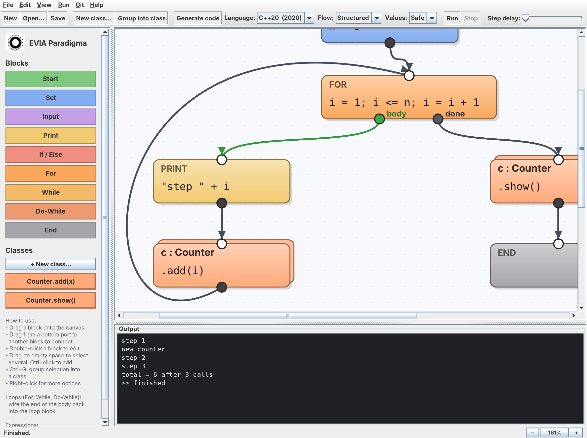</td>
<td>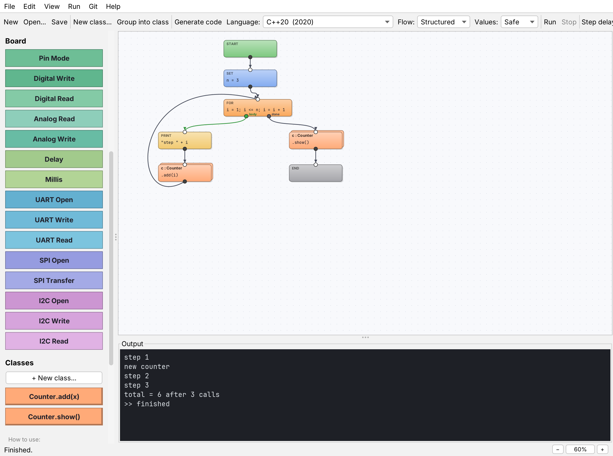</td>
</tr>
<tr><td align="center">Zoomed in (161%)</td><td align="center">Zoomed out (60%)</td></tr>
</table>

## Menus

| Menu | Items |
|---|---|
| **File** | New Program (Ctrl+N), New Project… (Ctrl+Shift+N), Open… (Ctrl+O, program, project file or folder), Open Project…, Open Example, Save (Ctrl+S), Save As…, Import Module…, Export Classes as Module…, Close Project, Exit |
| **Edit** | Select All, Delete, New Class…, Group Selection into Class (Ctrl+G), Open Class |
| **View** | Zoom In (Ctrl+=), Zoom Out (Ctrl+-), Actual Size (Ctrl+0), Fit Diagram in Window (Ctrl+9) |
| **Run** | Run (F5), Stop (Shift+F5), Generate Code (F7), Code Language and Mode (language, flow, values), Clear Output |
| **Git** | Initialize Repository, Commit… (Ctrl+K), Push (Ctrl+Shift+K), Pull, Connect to GitHub…, Open on GitHub, Status, History |
| **Linux** | New Linux Image…, Open Linux Image Folder…, Linux Images Window, Build Image, Write Image to SD Card…, Check This Computer, Terminal on the Board, Linux Images Guide: Buildroot, Yocto and OpenWrt for the BeagleBone Black and Raspberry Pi 5 |
| **Settings** | General… (Ctrl+,), C, C++ and Python…, Arduino Boards…, ESP32 Boards…, AVR C (bare metal)…, PIC32…, FPGA Boards…: each opens its tab of the Settings window |
| **Devices** | This Computer (C, C++, Python), Arduino Boards, ESP32 Boards, AVR C (bare metal), PIC32 Chips, FPGA Boards: each lists its boards (or languages); picking one sets the language and board, and each ends with its Settings page |
| **Help** | Guide (F1) with topics, Keyboard Shortcuts, Vim Keys, Examples, Tutorial (PDF; seven languages), Online Documentation, Report an Issue, Check for Updates, About |

<table>
<tr>
<td>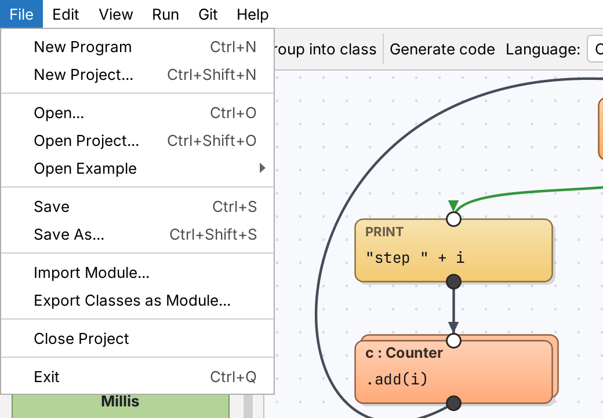</td>
<td>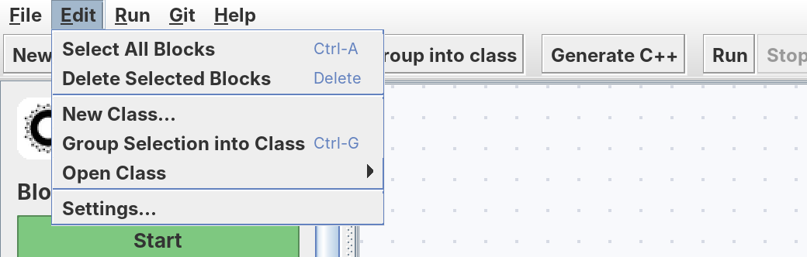</td>
<td>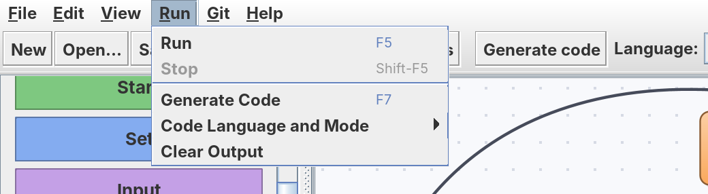</td>
</tr>
<tr>
<td>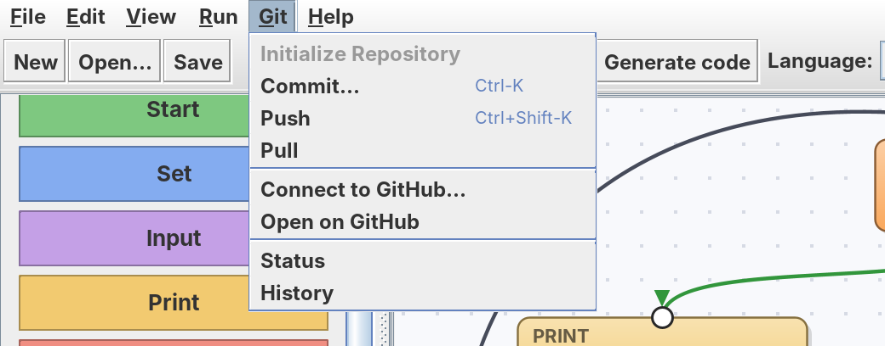</td>
<td>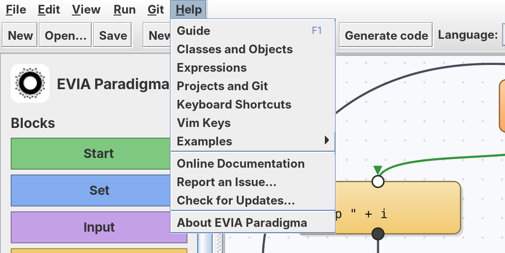</td>
<td></td>
</tr>
</table>

**Right-click a block → View source code** opens the generated code, in the chosen language, with exactly the lines
that block became highlighted. The same works for a method or class (class window → *View code*, or right-click a class
in the palette).

<p align="center">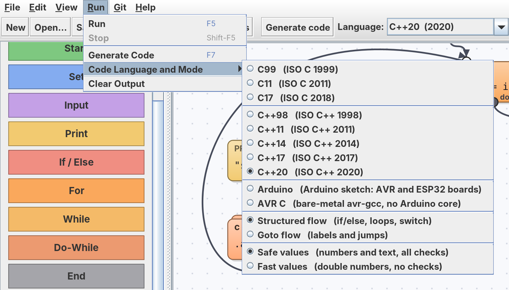</p>

## Projects and GitHub

**File → New Project…** creates a folder (by default in `~/EVIA Projects`):

```
MyProject/
  MyProject.eviaproj   project settings
  main.evia            the main program
  modules/             class modules (*.eviam)
  build/               generated C or C++ code (ignored by git)
  README.md
  .gitignore
```

When git is installed the project starts as a Git repository on branch `main` with a first commit.
The **Git** menu runs the git on your computer and uses the login it already has (Git Credential Manager,
an SSH key or `gh auth login`); EVIA Paradigma never asks for or stores passwords or tokens.

- **Commit…** saves the program and commits all changes; the message editor has Vim keys (`:w` commits).
- **Connect to GitHub…** takes `owner/repo` or a clone URL. *Create repository on GitHub…* opens
  github.com/new with the name filled in; create it empty, press OK, and the project is committed and pushed.
- **Push** / **Pull** (fast-forward only), **Status**, **History**, **Open on GitHub**.

## Vim

Vim is the text editor throughout EVIA Paradigma:

- **The code window** and **block code dialogs** use built-in Vim keys (toggle with the *Vim keys* checkbox or in Settings):
  - NORMAL, INSERT, VISUAL, VISUAL LINE modes, with counts
  - motions: `h j k l w W b B e E ge 0 ^ $ gg G f F t T ; , % { } n N`
  - operators: `d c y > <`, doubled, and text objects `iw aw i" a" i' i( a( i{ a{ i[ a[`
  - commands: `x X s S D C Y p P J r ~ u Ctrl-R .`, `i a I A o O`
  - registers: `"a`–`"z`, `"+` (system clipboard)
  - search: `/ ? * #`, and `:N`, `:s/a/b/g`, `:%s/…`, `:'<,'>s/…` (Java regex syntax)
  - in the code window: `:w`, `:w file.cpp`, `:q`, `:wq`, `:make` (compile & run), `:vim` (open in real Vim)
  - in block dialogs: Enter or `:w` accepts; Esc in NORMAL mode or `:q` cancels
- **Edit in Vim…** opens the code in the real Vim or gVim. Save and quit (`:wq`) and the changes come back.
  The command is set in Settings and detected automatically, e.g. `gvim -f {file}`.
- **Git commit messages:** `git config --global core.editor vim`

## C and C++ code generation

**Generate code** (F7) checks the program the same way Run does, then writes one self-contained source file. Three
drop-down lists in the main toolbar and in the code window choose the output (also **Run → Code Language and Mode**,
and `--lang` / `--flow` / `--values` on the [command line](#command-line)). A project remembers its choice. In the code
window you can edit the code, **Save** it, or **Compile & Run** it; text typed into **Input** goes to the program's stdin.

| Language | Standard | Classes become | Values (safe) | Objects |
|---|---|---|---|---|
| **C99**, **C11**, **C17** | ISO C 1999 / 2011 / 2018 | `struct Name` + functions `Name_m_method(Name *self, ...)`, `Name_new()` | `Value` (kind, number, text); text in a scratch arena | pointers, created on first use |
| **C++98** | ISO C++ 1998 | `struct` with member functions; not copyable | classic `Value` class | raw pointers, deleted by the owner |
| **C++11**, **C++14** | ISO C++ 2011 / 2014 | `struct` with member initializers | classic `Value` class | `std::unique_ptr` (`make_unique` in C++14) |
| **C++17**, **C++20** | ISO C++ 2017 / 2020 | `struct` with member initializers | `std::variant`, `std::to_chars` | `std::unique_ptr` |
| **Python 3** | Python 3.8 or newer | `class Name` with methods `m_method(self, ...)` | `float` or `str`, checked by small `rt_` helpers | attributes, created on first use |

| Flow | Generated control flow |
|---|---|
| **Structured** (default) | nested `if`/`else`, `for`, `while`, `do`/`while` and `switch` (for calls with several exits); labels and `goto` only where the wiring isn't block-structured |
| **Goto** | every block is a label and every wire a jump (fall-through where possible), closest to the block diagram |

| Values | Variables and fields | Checks |
|---|---|---|
| **Safe** (default) | numbers or text, exactly like the interpreter | undefined variables, division by zero, text that isn't a number, endless recursion (400 nested calls), field initial values |
| **Fast** | plain `double`; text only in **Print** (`"total = " + x` is printed piece by piece) | none: the code is what you would write by hand. A program that keeps text in a variable, an argument or a comparison is refused with the block that does it |

- Number output is identical in every language: whole numbers without `.0`, others like Java (`0.30000000000000004`,
  `1.0E-4`, `6.666666666666666E9`).
- The C runtime contains only the helpers the program uses, so the code compiles cleanly with
  `-Wall -Wextra -Wpedantic -Werror`. C needs `-lm`; EVIA Paradigma adds it, the matching C compiler (`clang`, `gcc`)
  and `-std=` to the compile command automatically.
- Every combination is tested in CI (see below): 9 languages (the 8 C and C++ standards and Python) × 2 flows × 2 value
  modes, with Clang and GCC.

```
clang   -std=c11   -O2 -o program program.c -lm
clang++ -std=c++98 -O2 -o program program.cpp
python3 program.py
```

### Python

**Language → Python 3** writes one `.py` file that needs only Python 3.8 or newer: no packages, nothing to compile.
**Run** in the code window starts it with the Python set in **Settings → Python**; by default EVIA Paradigma finds it
(`py` on Windows, `python3` on Linux and macOS).

- Python has no `goto`. *Structured* flow writes nested `if`/`else` and `while` loops (a *for* block becomes a `while`
  with its step at the end, a *do-while* a `while True` that tests at the end); where the wiring isn't
  block-structured, and always in *Goto* flow, the graph becomes a state machine: `while True:` with one `if`/`elif`
  branch per block and every wire written as `rt_s = "L7"`.
- *Safe* values are `float` or `str` with the interpreter's checks and messages; *Fast* values are plain floats
  (dividing by zero gives `Infinity` or `NaN`, as in C).
- Errors end the program with `>> error: ...` on stderr and exit code 1, exactly like the interpreter and the C and
  C++ programs.

### Java, Kotlin and Android

**Language → Java** writes one file with `class Program` (Java 17 or newer, nothing but the JDK); **Language →
Kotlin** one `.kt` file. **Compile & Run** in the code window builds and runs them with the JDK in **Settings → Java
and Kotlin** (found by itself from `JAVA_HOME` or the `javac` on PATH; **Get** downloads Eclipse Temurin 25) and, for
Kotlin, kotlinc (**Get** downloads JetBrains' compiler). Both are also packages of the EVIA server.

- Like Python, neither has `goto`: *Structured* flow writes nested `if`/`else` and `while` loops, and elsewhere (and
  always in *Goto* flow) the graph becomes a state machine, `while (true)` with one branch per block.
- *Safe* values are `Double` or `String` (`Object` / `Any`) with the interpreter's checks and messages; *Fast* values
  are plain `double`s. Text is printed exactly as the interpreter prints it (Java's own `Double.toString`).
- The Java file compiles cleanly with `javac -Xlint:all -Werror`, the Kotlin file with `kotlinc -Werror`, and both give
  the interpreter's output, errors and exit code for every example in every mode (`scripts/check-targets.sh`).

**Language → Android** makes an Android app of the program: `MainActivity.kt` runs it on a thread of its own, Print
lines appear on the screen, Input asks in a text field, and **Run again** starts it over. In the code window, **Build**
makes the APK and **Install on Phone** installs it with adb and starts it.

| | |
|---|---|
| What it needs | a JDK, kotlinc, and the Android SDK: platform `android-37.0` (Android 17), build-tools 37.0.0, platform-tools |
| Getting the SDK | **Settings → Android → Get Android SDK…** shows Google's licence (the text from Google's own index) and, once you accept it, downloads the three pieces from Google (about 140 MB). An SDK of Android Studio is found by itself |
| How it builds | without Gradle, in seconds: aapt2 links the manifest, kotlinc compiles, R8 keeps only the part of the Kotlin library the app uses (an APK of tens of KB), zipalign and apksigner sign it with the debug key `~/.android/debug.keystore` |
| The project | the project's `build/android/`, or `EVIA Projects/Android/<program>/`: also an ordinary Android Studio project (Gradle, Android Gradle plugin 9.5) |
| The phone | Android 7.0 or newer, USB debugging on (Settings → About phone: tap *Build number* seven times, then Developer options → USB debugging); **Settings → Android → Phone** picks one when several are connected |

**The phone's sensors**: the **Phone Sensor** block (palette group *Phone*) stores a reading in a variable, e.g.
`ax = ACCEL_X`: `ACCEL_X/Y/Z` (m/s²), `GYRO_X/Y/Z` (rad/s), `LATITUDE`, `LONGITUDE`, `ALTITUDE`, `GPS_ACCURACY` and
`GPS_FIX` (1 once the position is known). **Run** simulates a phone lying on a table; Language Android reads the real
accelerometer, gyroscope and GPS, and asks for the location permission only when the program reads the position.
**Delay** and **Millis** work in Java, Kotlin and Android as well. **File → Open Example → Android Phones** has
*Hello, world*, a *GPS viewer* and a *Motion tester* (accelerometer and gyroscope).

`scripts/check-android.sh` compiles the app of every example against an Android platform, runs its program part on the
computer with the console in place of the screen, compares it with the interpreter, and builds one APK.

## Native executables: EVIA Paradigma Native

**EVIA Paradigma Native** is the same editor, blocks, classes, projects and Run, without a Language list and without
a code window: **Build executable** (F7) turns the program straight into a **Linux x86-64 executable**, and **Run
executable** (F6) starts it, with Input typed in the field under the output. There is no C, no compiler, no
assembler and no linker anywhere: EVIA Paradigma's own back end writes the machine code and the ELF file itself.

| | |
|---|---|
| The executable | a static ELF file of about 33 KB that talks to the Linux kernel with system calls only (no libc, no shared libraries), so it runs on any x86-64 Linux |
| Behaviour | the interpreter's, exactly: the same output, error messages (`>> error: ...` on stderr) and exit code; numbers are written and read as Java writes and reads them (the shortest digits that read back, correctly rounded input) |
| Values | *Safe*: numbers and text with every check; *Fast*: plain doubles, text only in Print |
| Blocks | everything a desktop program uses, with classes and objects, plus **Delay** and **Millis**; the board, bus and phone blocks need their languages |
| How | the blocks are lowered to a small internal language (every block a label, every wire a jump), compiled with the runtime (strings, big-number arithmetic for the numbers, buffered output) to x86-64 by `NativeAsm`, and written by `NativeElf` |

The same compiler is in EVIA Paradigma too, on the command line:

```
java -jar evia-paradigma.jar --native program.evia -o program [--values fast]
./program
```

The edition is in this code too (`-Devia.edition=native`, or `--edition native` before the other arguments, and
`EDITION=native packaging/package.sh`), and since 0.11.0 it is a project of its own with its own installers and
releases: [EVIA Paradigma Native](https://github.com/sbrutyan01/EVIA-Paradigma-Native). `scripts/check-native.sh` compiles every example and test program in both value modes and compares each
executable with the interpreter, and checks 100,000 numbers against Java's. Windows and ARM executables are next.

## Arduino and ESP32 boards

Four more entries in the **Language** list make code for microcontrollers. Both always use fast values (numbers; text
only in Print). Print and Input go over the serial port at 115200 baud.

| Language | Boards | Output | Build and upload |
|---|---|---|---|
| **Arduino** | Arduino Uno, Nano, Mega 2560, Leonardo, Micro, Pro Mini (5 V, 16 MHz); ESP32, ESP32-S2, ESP32-S3, ESP32-C3, ESP32-C6, ESP32-H2; the six STM32 boards | one sketch, `program/program.ino`, with `setup()` and `loop()`; text in flash (`F()`) on AVR boards | `arduino-cli compile` / `upload` with the `arduino:avr`, `esp32:esp32` and `STMicroelectronics:stm32` cores (STM32: uploaded with OpenOCD) |
| **AVR C** | the six AVR boards: ATmega328P (Uno, Nano, Pro Mini), ATmega2560 (Mega 2560), ATmega32U4 (Leonardo, Micro) | bare-metal C: no Arduino core. `pinMode`, `digitalWrite`, `analogRead`, `analogWrite`, `millis` and `delay` written against the chip's registers, with Arduino's pin numbers, timer setup and a 115200-baud UART (USART1 on pins 0/1 for the ATmega32U4) | `avr-gcc -mmcu=… -Os`, `avr-objcopy`, `avrdude` |
| **PIC32 C** | nine PIC32MX chips: MX1xx/2xx (150F128B, 250F128B, 270F256B), MX3xx/4xx (320F128H, 340F512H, 440F256H, 460F512L), MX5xx/6xx/7xx (695F512L, 795F512L), plus two ready-made boards: the PIC32 Ethernet Starter Kit II (MX795F512L, LED1 on RD0) and the chipKIT Pro MX7 (MX795F512L, LD1 on RG12, Ethernet) | bare-metal C for XC32, no Harmony or plib: the same Arduino-style functions written against the registers. 30 MHz from the internal oscillator, UART1 at 115200 baud, 10-bit ADC, PWM on the output compare modules | `xc32-gcc -mprocessor=32MX… -Os`, `xc32-bin2hex`, then an upload command (default `pic32prog {hex}`) |
| **STM32 C** | Blue Pill (STM32F103C8), Black Pill (STM32F411CE), Nucleo-F401RE, Nucleo-F411RE, STM32F4DISCOVERY (STM32F407VG), 32F429IDISCOVERY (STM32F429ZI) | bare-metal C for arm-none-eabi-gcc, no HAL or CMSIS: the same Arduino-style functions written against the registers, with the vector table, start-up code and linker script in the file. 64 MHz (F1), 84 MHz (F401/F411) or 168 MHz (F407, F429) from the internal oscillator, Print on USART1 (PA9/PA10) or USART2 (PA2/PA3, the Nucleo's ST-Link serial port), PWM on TIM2–TIM4, 12-bit ADC (A0–A15), SPI1, I2C1 | `arm-none-eabi-gcc -mcpu=cortex-m3/m4 -T stm32.ld …`, then OpenOCD through an ST-Link (`openocd -f interface/stlink.cfg -f target/stm32f1x.cfg -c "program program.elf verify reset exit"`) |

The generated code is the same for every board of a language. Pins are written as `LED_BUILTIN`, `A0` and so on, and
each board's headers say where they are. The **Board** list next to the language (and in Settings, with the serial port
and the tool paths) only decides what **Build** and **Upload** in the code window do.

<p align="center">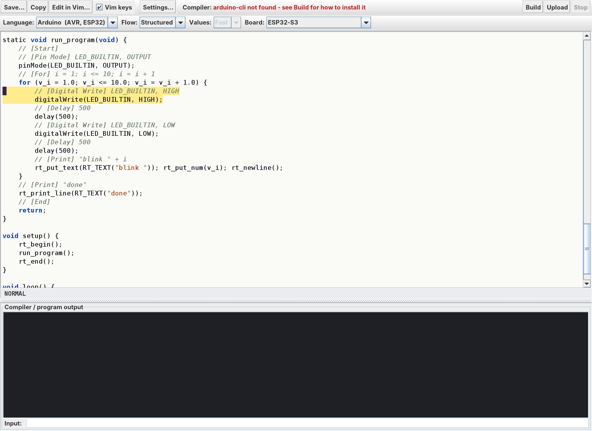</p>

| Block | Code | What it does |
|---|---|---|
| **Pin Mode** | `LED_BUILTIN, OUTPUT` | `OUTPUT`, `INPUT` or `INPUT_PULLUP` |
| **Digital Write** | `LED_BUILTIN, HIGH` | `HIGH` for any non-zero value, `LOW` for 0 |
| **Digital Read** | `pressed = 4` | stores 1 (HIGH) or 0 (LOW) |
| **Analog Read** | `level = A0` | 0..1023 on AVR boards, 0..4095 on ESP32 |
| **Analog Write** | `5, brightness` | PWM duty 0..255 |
| **Delay** | `500` | waits this many milliseconds |
| **Millis** | `t` | milliseconds since the program started |
| **UART Open** | `9600` | starts the serial port of the UART blocks at this baud rate |
| **UART Write** | `65` | sends one byte (0..255) |
| **UART Read** | `c` | next received byte, or -1 if none |
| **SPI Open** | `1000000` | SPI master at this clock in Hz (mode 0, MSB first) |
| **SPI Transfer** | `reply = 66` | sends a byte, stores the byte received at the same time |
| **I2C Open** | `100000` | I2C master at this clock in Hz |
| **I2C Write** | `80, 0, 42` | address (7-bit), register, value |
| **I2C Read** | `v = 80, 0` | stores the register's value, or -1 if nothing answers at that address |
| **MQTT Connect** | `"network", "password", "broker.example.com", 1883` | joins the network and connects to the broker |
| **MQTT Publish** | `"evia/temperature", t` | sends a message: a number or a text |
| **MQTT Subscribe** | `"evia/command"` | asks the broker for that topic (up to four) |
| **MQTT Has Message** | `waiting = "evia/command"` | 1 when a message of that topic is waiting, 0 when none is |
| **MQTT Read** | `cmd = "evia/command"` | the number in the next message, or -1 if none has arrived |

**Run** simulates an Arduino Uno, so board programs can be tried without a board:
- every pin change appears in the output (`board [500 ms] pin 13 HIGH`), separately from the program's output;
- time is virtual and only Delay moves it, so runs are repeatable (the main window also really waits, unless the speed
  slider is at full speed);
- a button on each input pin is pressed during the second half of every 2 seconds;
- analog pins read a slow wave 0..1023..0;
- the UART's transmitter is wired to its receiver, so UART Write bytes come back from UART Read (and also appear as output
  text); SPI's input is wired to its output; one I2C device with 256 registers (all 0) answers at address 80, other
  addresses do not answer. Using SPI or I2C before its Open block is an error.

On a board the program runs once from `setup()`, and the pins keep their state afterwards. Desktop C and C++
can't use the Board blocks; Generate code names the block.

**PIC32 pins** are fixed per chip family and listed at the top of the generated file. MX1xx/2xx: UART1 on RB13 (RX) and
RB3 (TX), SPI1 on RA1 (in), RA4 (out) and RB14 (clock), I2C1 on RB8 (SCL) and RB9 (SDA), PWM on RB15, RB8, RB9 and RB2.
MX3xx to MX7xx: UART1 on RF2 and RF3 (RF8 on some packages), SPI2 on RG7, RG8 and RG6, I2C1 on RG2 and RG3 (RA14 and RA15
on 100-pin chips), PWM on RD0..RD4. Pin numbers are `16 * port + bit`, and `RA0` ... `RG15` are defined.

**What is checked for PIC32, and what is not:** CI compiles every example for the boards of all three families with a PC
gcc (`-Wall -Wextra -Werror`, syntax only) against Microchip's real device headers, which proves that every register and
bit name exists with the right type. It does **not** run the program, and nothing here has built it with XC32 or run it on
a chip, so pin assignments, `#pragma config` names for a particular part, and timing are unproven. Treat the first
build on real hardware as a test, and please report what you find.

<p align="center">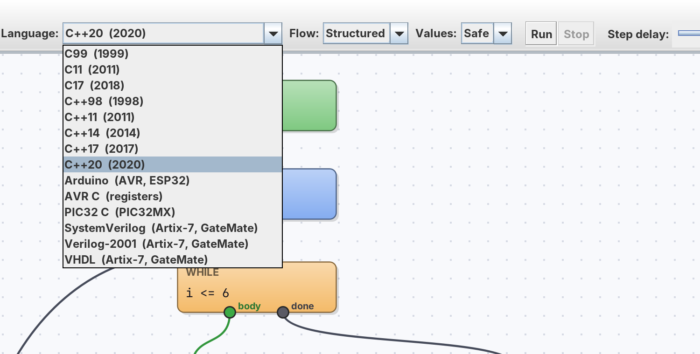</p>

How the board code is tested: CI builds the bare-metal AVR C of every board example for all three chips with
`-Wall -Wextra -Werror`, in both flows, and runs each build in [simavr](https://github.com/buserror/simavr). The
simulator gets the same button and analog signal as EVIA Paradigma's simulated Uno. The UART output must match the
interpreter, and the built-in LED must switch the same number of times on the right port bit (PB5, PB7 or PC7). The
Arduino sketches are built with arduino-cli for all 12 boards, and the Uno and Mega 2560 builds run in simavr too.

## FPGA: Artix-7 and GateMate

Three more entries in the **Language** list, **SystemVerilog**, **Verilog-2001** and **VHDL** (VHDL-2008), turn the
diagram into hardware. All three write the same circuit; choose by what your tools and course use. The **Board** list
next to the language picks the board, and with it the chip, the clock and the pin constraints.

| Board | Chip | Clock | Pins the design can use |
|---|---|---|---|
| Digilent **Nexys A7-100T** | Artix-7 XC7A100T | 100 MHz | `LED0`..`LED15`, `SW0`..`SW15`, `BTNC` `BTNU` `BTNL` `BTNR` `BTND`, Pmod `JA`..`JD`, USB-UART |
| Digilent **Arty A7-35** and **A7-100** | Artix-7 XC7A35T, XC7A100T | 100 MHz | `LED0`..`LED3`, `SW0`..`SW3`, `BTN0`..`BTN3`, Pmod `JA`..`JD`, USB-UART |
| Digilent **Basys 3** | Artix-7 XC7A35T | 100 MHz | `LED0`..`LED15`, `SW0`..`SW15`, `BTNC` `BTNU` `BTNL` `BTNR` `BTND`, Pmod `JA`..`JC`, USB-UART |
| **Olimex GateMateA1-EVB** | GateMate CCGM1A1 | 10 MHz | `LED0`, `BTN0`, the RP2040's debug UART |
| **Cologne Chip GateMate A1** evaluation board | GateMate CCGM1A1 | 10 MHz | `LED0` only, no serial port |

Pins have the same names on every board and in **Run**: `LED_BUILTIN` is `LED0`, and a Pmod connector's signal pins
are `JA1` `JA2` `JA3` `JA4` `JA7` `JA8` `JA9` `JA10` (pins 5 and 6 are ground and power). A pin the board does not have is an
error that lists the pins it has. The two GateMate boards offer only the pins whose location is known from the manufacturers'
files; more can be added in [`Fpga.java`](src/main/java/evia/paradigma/Fpga.java).

**How a diagram becomes hardware**

- Each block is one **state** of a state machine and takes one clock cycle. Variables are **signed 32-bit** registers
  that start at 0. There is one clock input, one port per pin the program uses, and `uart_tx` / `uart_rx` if it uses the serial port.
- **Pin Mode**, **Digital Write**, **Digital Read** and **Analog Write** drive and read the pins. Reading a switch or button
  goes through two flip-flops. Analog Write is 8-bit PWM (about 1.5 kHz at 100 MHz). A pin must be a **constant** (a number
  or a name like `LED0`) because it is wired when the design is built, and a pin can't be both read and written.
- **Delay** counts exact clock cycles, **Millis** is a free-running millisecond counter.
- **Print** and the **UART** blocks share one serial port, 115200 baud unless **UART Open** says otherwise. Numbers are printed
  in decimal, text comes from a table, and every Print ends with a carriage return and line feed. The receiver keeps one byte,
  so read it before the next one arrives.
- `/` and `%` use one shared divider (about 35 clock cycles each).
- Not supported yet (the error names the block): classes, **Input**, **Analog Read**, **SPI** and **I2C**, and text in variables
  or comparisons (text works in Print).

**Whole numbers.** `+ - *` wrap around at 32 bits; `/` and `%` truncate toward zero and give 0 for a zero divisor. **Run**
uses double numbers, so `5 / 2` is 2.5 in Run and 2 in the hardware, and a fractional number in the diagram is an error when
generating. The bundled examples are written so that Run and the hardware agree.

**Building.** Generate the code (F7), then **Build** or **Upload** in the code window. The pin constraints are in the header
comment of the generated file; on the command line `-o design.sv` also writes `design.xdc` (Artix-7) or `design.ccf` (GateMate).

| Chip | Build | Upload |
|---|---|---|
| Artix-7, **Vivado** (default) | `vivado -mode batch -source build.tcl`: read, synthesise, place, route, `write_bitstream` | Vivado Hardware Manager |
| Artix-7, **open source** (choose in Settings) | yosys `synth_xilinx`, nextpnr-xilinx, `fasm2frames`, `xc7frames2bit` ([openXC7](https://github.com/openXC7)) | `openFPGALoader --board …` |
| GateMate | yosys `synth_gatemate`, nextpnr-himbaechel, `gmpack` | `openFPGALoader --board …` |

Settings holds the Artix-7 flow and the path of each tool; VHDL through yosys needs its ghdl plugin. The upload is volatile: the
board forgets the design at power off.

**What is checked, and what is not.** [`scripts/check-fpga.sh`](scripts/check-fpga.sh) (CI job `fpga`) generates nine test
programs in all three languages and simulates them, SystemVerilog and Verilog with Icarus Verilog and VHDL with GHDL, against
the interpreter: pin changes, printed text, serial bytes, PWM duty and the divider (against a 32-bit reference) agree, 27 of 27. It
also synthesises every example with yosys for Artix-7 and takes the GateMate designs through nextpnr-himbaechel to a
bitstream. It does **not** run Vivado, nextpnr-xilinx or openFPGALoader, and nothing has been loaded into a board. The Artix-7
pin locations come from Digilent's published master constraint files, the GateMate ones from Olimex's KiCad design and Cologne
Chip's example, and the `.xdc` and `.ccf` follow their formats, but no vendor tool has read them. Whether the Olimex board's debug UART
reaches the USB port depends on the RP2040 firmware. Treat the first build on your board as a test, and please report what you find.

## Command line

### The `evia` command

The installers put an `evia` command next to the app (`evia.exe` on Windows). With a plain jar, run
`scripts/install-cli.sh` (copies the jar to `~/.local/share/evia` and `packaging/cli/evia` to `~/.local/bin`), or use
`java -jar evia-paradigma.jar gen ...`.

```
evia gen app.evia -l python -o app.py               # one language (standard output without -o)
evia gen app.evia -l c11,python,java,kotlin -d out/ # several: out/app.c, app.py, app.java, app.kt
evia gen blink.evia -l arduino -b uno -o blink/blink.ino
evia gen top.evia -l sv -b basys3 -o top.sv         # also writes top.xdc
evia watch app.evia -l python -o app.py             # write it again every time app.evia is saved
evia check app.evia                                 # does it generate for every language? (exit code 0/1)
evia run app.evia                                   # run with the interpreter
evia native app.evia -o app                         # Linux x86-64 executable, no compiler
evia langs                                          # languages; evia boards [LANG] for boards
evia new hello.evia                                 # start from the example
evia help gen
```

Options of `gen` and `watch`: `-l LANGS` (comma separated, or `all`), `-o FILE`, `-d DIR`, `-b BOARD`,
`--flow structured|goto`, `--values safe|fast`, `--net uart|ethernet`, `-q`. The options below (`--gen`, `--linux` ...)
still work, also as `evia --gen ...`.

### Options

```
java -jar evia-paradigma.jar --run program.evia              # run with the interpreter
java -jar evia-paradigma.jar --run MyProject                 # a project folder runs its main program
java -jar evia-paradigma.jar --gen program.evia -o prog.cpp  # generate C++20 (structured, safe values)
clang++ -std=c++20 -O2 -o prog prog.cpp && ./prog

# other languages and modes
java -jar evia-paradigma.jar --gen program.evia --lang c11 -o prog.c
java -jar evia-paradigma.jar --gen program.evia --lang c++98 --flow goto --values fast -o prog.cpp
clang -std=c11 -O2 -o prog prog.c -lm && ./prog
java -jar evia-paradigma.jar --gen program.evia --lang python -o prog.py && python3 prog.py
java -jar evia-paradigma.jar --gen program.evia --lang java -o Program.java && java Program.java
java -jar evia-paradigma.jar --gen program.evia --lang kotlin -o prog.kt
kotlinc prog.kt -include-runtime -d prog.jar && java -jar prog.jar
```

Android apps:

```
java -jar evia-paradigma.jar --android-sdk                   # shows Google's licence; add --accept-license to download
java -jar evia-paradigma.jar --android counter.evia ~/apps/counter --name "Counter"            # the project folder
java -jar evia-paradigma.jar --android counter.evia ~/apps/counter --install                   # build, install, start
```

Boards:

```
java -jar evia-paradigma.jar --gen blink.evia --lang arduino -o blink/blink.ino
arduino-cli compile --fqbn esp32:esp32:esp32s3 blink
java -jar evia-paradigma.jar --gen blink.evia --lang avr -o blink.c
avr-gcc -mmcu=atmega328p -DF_CPU=16000000UL -Os -o blink.elf blink.c -lm && avr-objcopy -O ihex blink.elf blink.hex
java -jar evia-paradigma.jar --gen blink.evia --lang pic32 --board pic32mx795f512l -o blink.c
xc32-gcc -mprocessor=32MX795F512L -std=gnu99 -Os -o blink.elf blink.c -lm && xc32-bin2hex blink.elf   # then pic32prog blink.hex
java -jar evia-paradigma.jar --run blink.evia                # simulated Uno; pin changes go to stderr
java -jar evia-paradigma.jar --gen examples/fpga/blink.evia --lang sv --board nexys-a7-100t -o blink.sv   # also writes blink.xdc
java -jar evia-paradigma.jar --gen examples/fpga/blink.evia --lang vhdl --board olimex-gatemate -o blink.vhd   # also writes blink.ccf
```

Linux images (Buildroot, Yocto or OpenWrt for a BeagleBone Black or Raspberry Pi 5):

```
java -jar evia-paradigma.jar --linux ~/evia-linux/bbb --system buildroot --board bbb --python --packages "htop nano"
~/evia-linux/bbb/build.sh all                                # fetch, configure, build: output/images/sdcard.img
java -jar evia-paradigma.jar --linux ~/evia-linux/router --system openwrt --board rpi5 --password-file pw.txt
```

This lets you write a program in the editor and then generate and build it from Vim (`:!java -jar … --gen %`)
or a Makefile.

## Continuous integration

Every push runs [`.github/workflows/build.yml`](.github/workflows/build.yml), which:
1. builds the jar with Maven on JDK 25,
2. installs Clang 23 from apt.llvm.org,
3. runs [`scripts/check-examples.sh`](scripts/check-examples.sh). For each program in [`examples/`](examples) it generates C++,
   compiles it with `-Wall -Wextra -Wpedantic -Werror`, and requires the compiled program and the interpreter to produce
   identical stdout, stderr and exit codes,
4. runs [`scripts/check-app.sh`](scripts/check-app.sh): classes and modules (export, import, reload), the
   *View source code* line mapping (C and C++), project creation and the Git commands against a local bare repository,
5. runs [`scripts/check-zoom.sh`](scripts/check-zoom.sh) on the real main window under Xvfb: wheel zoom keeps the
   point under the pointer in place, stops at 25% and 300%, Shift/Ctrl+wheel scroll, saved files don't change with
   the zoom, dragging and dropping land in the right place,
6. runs [`scripts/check-targets.sh`](scripts/check-targets.sh) with Clang 23 and with GCC: every program in `examples/`
   and [`tests/programs/`](tests/programs) (numbers, text, objects, recursion, unstructured wiring and every runtime
   error) in all 32 combinations of language (C99 … C++20), flow and values, compiled with
   `-Wall -Wextra -Wpedantic -Werror` and compared with the interpreter (stdout, stderr, exit code). The Windows job
   does the same with llvm-mingw Clang and with WinLibs GCC (both `-static`) and checks that no program needs a
   Visual Studio or compiler DLL,
7. the **boards** job runs [`scripts/check-boards.sh`](scripts/check-boards.sh): the board examples as bare-metal AVR C
   (avr-gcc 14, `-Werror`) for the ATmega328P, ATmega2560 and ATmega32U4, each run in simavr and compared with the
   interpreter (UART output, LED switching); and as Arduino sketches built with arduino-cli for all 12 boards.
8. the **pic32** job runs [`scripts/check-pic32.sh`](scripts/check-pic32.sh): every board example, for the boards of the
   three PIC32MX families and both flows, compiled syntax-only with gcc (`-Wall -Wextra -Werror`) against Microchip's
   real device headers (fetched from the Pinguino project; they are not part of this repository). There is no XC32
   compiler or chip in CI.
9. the **pic32** job also runs [`scripts/check-mqtt.sh`](scripts/check-mqtt.sh): the generated MQTT client is compiled on
   the build machine with its network functions replaced by an ordinary socket and run against a small broker, which
   checks the CONNECT, the SUBSCRIBE and the published text and numbers and sends messages back; the ESP32 sketch is
   compiled as C++ against stub Arduino headers. No WiFi module, ESP32 or PIC32 chip is part of that.
10. the **fpga** job runs [`scripts/check-fpga.sh`](scripts/check-fpga.sh) with the OSS CAD Suite: nine test programs in all
   three HDLs simulated (Icarus Verilog, GHDL) and compared with the interpreter, every example synthesised with yosys for
   Artix-7, and the GateMate designs placed, routed and packed into a bitstream. There is no Vivado or board in CI.

The website is built by [`.github/workflows/pages.yml`](.github/workflows/pages.yml) whenever `site/`, the screenshots,
the tutorial example or the code generator change, and when a release is published:
[`scripts/build-site.py`](scripts/build-site.py) copies [`site/`](site) and the screenshots, generates the tutorial
program in all 32 language/flow/values combinations with the freshly built jar (so the code shown on the front page
is always the real output), and pushes the result to the `gh-pages` branch. The site has a light and a dark theme: it follows
the system setting, and the **Light / Dark** buttons in its header choose one and remember it.

**If a release ends up without installers** (for example a download failed while it was being built):
open **Actions → release → Run workflow**, enter the tag (e.g. `v0.2.1`) and run it. It builds that tag's
sources and attaches the installers to its release. The Clang download retries and, if apt.llvm.org is down,
falls back to Ubuntu's Clang with a warning.

Reports: [v0.1.2: CI checks and release files (PDF)](docs/reports/EVIA-Paradigma-0.1.2-CI.pdf) · [SHA-256 checksums](docs/reports/SHA256SUMS-0.1.2.txt)

## Running the checks on a machine of your own

[`scripts/local-ci.sh`](scripts/local-ci.sh) runs the same checks GitHub runs, with the toolchains already
installed on that machine instead of downloading them each time. A check whose tool is missing is skipped with the
reason, so a computer without, say, XC32 still runs everything else; the exit status is the number of failures.

```bash
scripts/local-ci.sh                 # build, then every check whose tools are present
scripts/local-ci.sh app mqtt        # only those: build app mqtt examples targets zoom pic32 boards fpga
```

[`scripts/setup-toolchains.sh`](scripts/setup-toolchains.sh) installs the outside ones into `/opt`, each in its own
folder: `--check` reports what is there, `--fpga` fetches the OSS CAD Suite (yosys, nextpnr, iverilog, ghdl, gmpack),
`--avr` fetches avr-gcc and arduino-cli with its cores and builds simavr. It finishes by printing the two lines to put
in the runner's environment or in the repository variables.

Point it at your toolchains with `OSS_CAD_SUITE` (the folder holding its `environment` file), `XC32_BIN`,
`AVR_GCC_BIN`, and `CXX` / `CC`.

[`scripts/setup-runner.sh`](scripts/setup-runner.sh) does the setting up: `--check` prints what the machine has and
what is missing, and `--token <TOKEN>` installs the build tools and a Java 25 if needed, fetches the current runner,
registers it and installs it as a service that starts with the machine.

```bash
scripts/setup-runner.sh --check
scripts/setup-runner.sh --token <FROM THE RUNNERS PAGE> --name dell --labels self-hosted,linux,dell
```

To do it by hand instead, register it as a **self-hosted runner** (Settings → Actions → Runners → New
self-hosted runner gives the exact commands, pinned to the current runner version), with the labels this repository's
workflow expects:

```bash
./config.sh --url https://github.com/sbrutyan01/EVIA-Paradigma --token <FROM THAT PAGE> \
            --name dell --labels self-hosted,linux,dell --unattended
sudo ./svc.sh install "$USER" && sudo ./svc.sh start      # starts with the machine
```

Then **Actions → local-ci → Run workflow** runs [`local-ci.yml`](.github/workflows/local-ci.yml) there, and the box
needs no incoming connection at all: the runner polls GitHub outbound, so nothing has to be forwarded on the router.

> **This repository is public, so the workflow is `workflow_dispatch` only, on purpose.** A self-hosted runner that a
> pull request can trigger would run a stranger's code on your computer. Keep that trigger as it is, keep
> *Settings → Actions → General → Require approval for all external contributors* on, and prefer a machine you can
> rebuild over your main desktop.

## Code map

| File | Role |
|---|---|
| `App.java` / `Cli.java` | Entry point; command-line mode |
| `MainFrame.java` | Main window, menus, projects, Git menu; runs the interpreter in a `SwingWorker` |
| `ClassEditor.java` / `InstanceDialog.java` | Class window (fields, methods); method/object/arguments of a call |
| `Library.java` / `BlockDef.java` / `Method.java` | Classes, their fields and methods, keeping calls in sync |
| `Grouper.java` | Turns a selection into a class plus a call |
| `Project.java` / `GitService.java` / `GitDialogs.java` | Project folders; the installed git; commit and GitHub dialogs |
| `HelpWindow.java` | Guide (`help/guide.html`), tutorial PDFs, links, update check |
| `PalettePanel.java` / `FlowCanvas.java` / `Block.java` | Palette, editing surface, blocks |
| `ExprParser.java` / `Expr.java` | Recursive-descent parser → AST (sealed interface + records) → evaluator |
| `Interpreter.java` | Compile pass, then execution with per-object state |
| `ProgramIO.java` | `.evia` programs and `.eviam` modules (format v3; v2 still loads) and the built-in example |
| `CodeGenerator.java` | C and C++ generation: structured or goto flow, safe or fast values, source map for *View source code* |
| `Runtimes.java` / `CppRuntime.java` | The embedded runtimes: C (only the pieces a program uses), C++98–14, C++17/20, fast values |
| `Target.java` / `TargetBar.java` | Language / flow / values choice and its drop-down lists |
| `CodeViewer.java` | Code window: Vim keys, save, compile & run with the matching compiler and `-std=` |
| `VimKeys.java` | Vim emulation for Swing text components |
| `ExternalEditor.java` / `CodeEditDialog.java` | Real Vim integration; Vim-enabled block code dialog |
| `Settings.java` | Vim, editor and compiler settings; Clang version check |
| `AppIcon.java` | EVIA logo icons and About dialog |
| `Board.java` / `BoardSim.java` | The 28 boards (arduino-cli names, AVR chips, PIC32MX chips, FPGA boards); the simulated board used by Run |
| `HdlGenerator.java` / `Rtl.java` / `Fpga.java` | FPGA: flowchart to state machine, written as SystemVerilog, Verilog-2001 or VHDL; the boards' pins and clocks, constraint files and build commands |
| `scripts/fpga/` | FPGA checks: test programs, simulation against the interpreter (Icarus Verilog, GHDL), synthesis (yosys, nextpnr) |
| `EmbeddedRuntime.java` | Arduino sketch and bare-metal AVR runtimes (pins, timers, PWM, ADC, UART), only the pieces a program uses |
| `EmbeddedRuntime.MQTT_CORE` / `Pic32Runtime.java` | The MQTT 3.1.1 client that goes into the generated file, and the network under it: the ESP32's WiFi, or a WiFi module on the PIC32's UART2 |
| `Toolchains.java` | Fetches arduino-cli, avr-gcc and the OSS CAD Suite into the app's own folder; XC32 opens Microchip's page |
| `scripts/local-ci.sh`, `scripts/setup-runner.sh`, `scripts/setup-toolchains.sh`, `.github/workflows/local-ci.yml` | The whole check suite on a machine of your own, through a self-hosted runner |
| `scripts/mqtt/harmony-stubs/` | Our own declarations of the Harmony API and the chip registers, so CI can compile the Ethernet application without Microchip's headers |
| `scripts/mqtt/` | The MQTT check: a socket in place of the chip's network, and a small broker that reads what the client sends |
| `scripts/simavr/` | `evia_sim`: runs AVR builds in simavr with a button, an analog signal and pin watching (CI) |
| `site/` / `scripts/build-site.py` | The [project website](https://sbrutyan01.github.io/EVIA-Paradigma/) and its build; `site/i18n/` holds its Russian, Armenian, German, Simplified Chinese, Traditional Chinese and Japanese texts |
| `docs/tutorial/` | The tutorial in seven languages, as Markdown and as the PDFs the app opens |

## Screenshots

All pictures are in [`docs/screenshots`](docs/screenshots). They are taken from the running application by
[`scripts/take-screenshots.sh`](scripts/take-screenshots.sh), which drives the UI through the tutorial above.

| | |
|---|---|
| 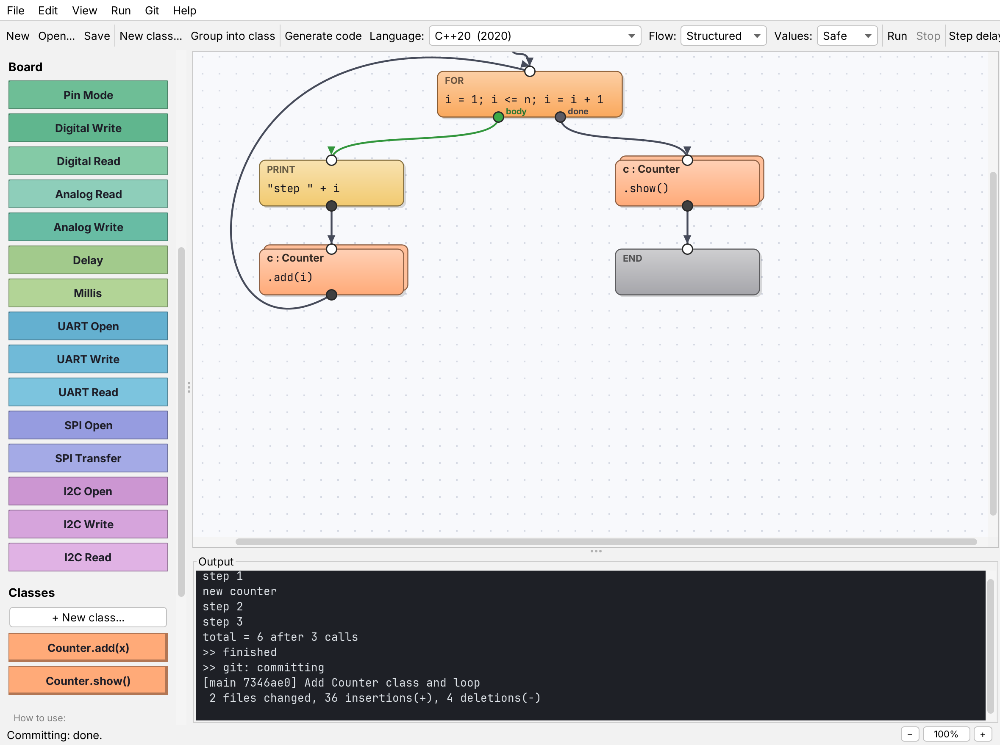 |  |
| Main window | Class window: a method |
|  |  |
| View source code (C++20) | Compile & Run with Clang |
|  |  |
| The same program as C11 | C++17, goto flow, fast values |
|  |  |
| Blink on the simulated Uno | Arduino sketch for an ESP32-S3 |
|  | 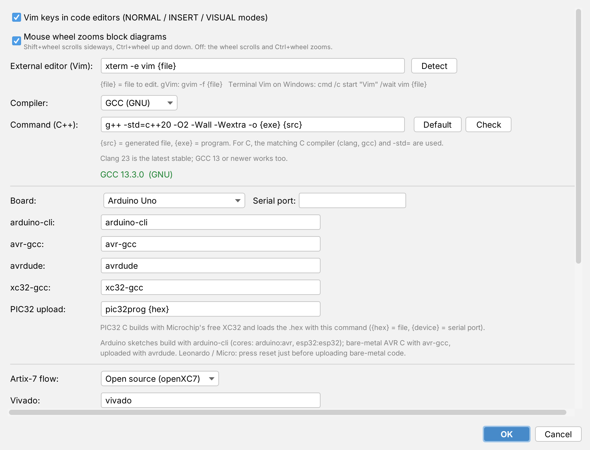 |
| Bare-metal AVR C built with avr-gcc | Settings: Clang or GCC, board tools |
|  |  |
| New project with Git | Help → Guide |

## License

EVIA Paradigma is released under the [MIT License](LICENSE). Copyright (c) 2026 Sergey Brutyan (sbrutyan01).
