# EVIA Paradigma: Tutorial

[English](TUTORIAL.md) · [Русский](TUTORIAL.ru.md) · [Հայերեն](TUTORIAL.hy.md) · **Deutsch** · [简体中文](TUTORIAL.zh-CN.md) · [繁體中文](TUTORIAL.zh-TW.md) · [日本語](TUTORIAL.ja.md) · [Website](https://sbrutyan01.github.io/EVIA-Paradigma/de/)

Dieses Tutorial führt durch ein kleines Projekt mit Schleife und Klasse. Wir führen es aus, betrachten den erzeugten C- und C++-Code und speichern das Projekt in Git. Anschließend programmieren wir ein Arduino- oder ESP32-Board. Alle Abbildungen stammen aus der echten Anwendung. Die Benutzeroberfläche ist auf Englisch; Menüs und Schaltflächen werden daher so bezeichnet, wie sie auf dem Bildschirm erscheinen.

## 1. Projekt erstellen

Wähle **File → New Project…** (Ctrl+Shift+N), gib einen Namen und Speicherort ein und lasse *Create a Git repository* aktiviert, wenn Git installiert ist.

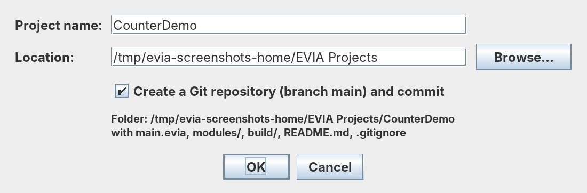

Das Projekt wird mit dem Startprogramm *Start → Print → End* geöffnet. Im Ausgabefeld siehst du, dass Git das Repository und den ersten Commit angelegt hat.

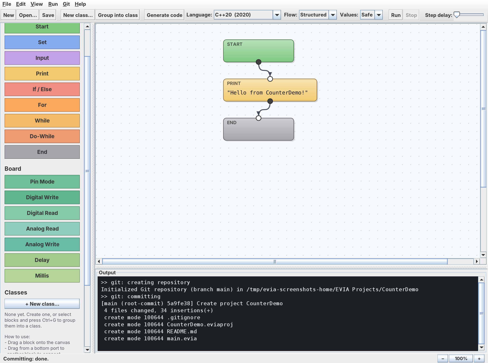

## 2. Schleife erstellen

Ziehe Blöcke aus der Palette auf die Arbeitsfläche und verbinde sie: Ziehe vom unteren Anschluss (dunkler Punkt) eines Blocks zum oberen Anschluss (weißer Punkt) des nächsten. Ein Doppelklick auf einen Block öffnet seinen Code zur Bearbeitung.

- **Set**: `n = 3`
- **For**: `i = 1; i <= n; i = i + 1`. Verbinde den Anschluss `body` mit **Print** `"step " + i`. Verbinde das Ende des Schleifenkörpers **zurück mit dem For-Block**, damit der nächste Durchlauf beginnt. Der Anschluss `done` führt zu **End**.

Drücke **Run** (F5). Mit *Step delay* kannst du beobachten, wie der aktive Block wandert. Mit dem Mausrad über dem Diagramm kannst du [zoomen](../../README.md#zoom).

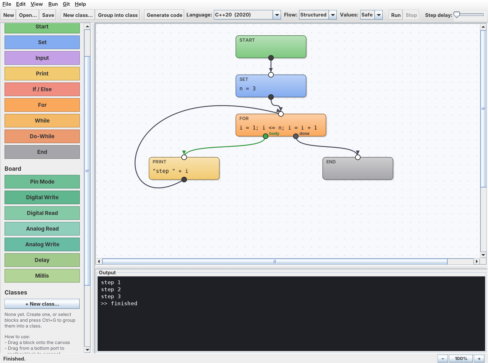

## 3. Klasse erstellen

Wähle **Edit → New Class…** (oder *+ New class…* in der Palette) und nenne die Klasse `Counter`. Das Klassenfenster enthält die Registerkarte **Fields** und je eine Registerkarte pro Methode.

Füge unter **Fields** `total` und `calls` hinzu, beide mit dem Startwert `0`. Jedes Objekt erhält eigene Feldkopien.

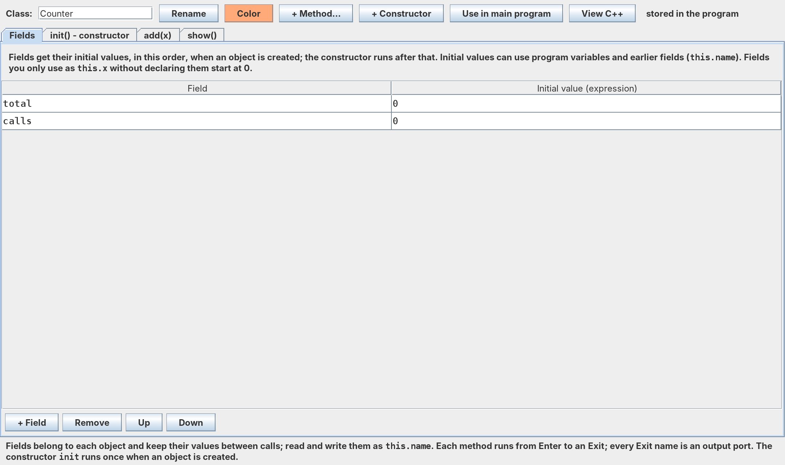

Benenne die erste Methode in `add` mit dem Parameter `x` um (drücke **Apply**) und erstelle ihren Körper von **Enter** bis **Exit**. Innerhalb einer Methode werden Felder und Parameter als `this.name` geschrieben.

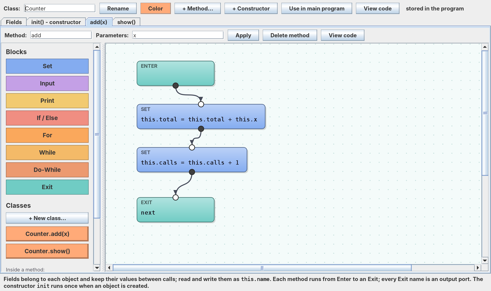

**+ Constructor** fügt `init` hinzu. Diese Methode wird einmal beim Erstellen eines Objekts ausgeführt, nachdem die Felder ihre Anfangswerte erhalten haben. Hier gibt sie `"new counter"` aus. Mit **+ Method…** fügst du `show` hinzu, das `"total = " + this.total + " after " + this.calls + " calls"` ausgibt.

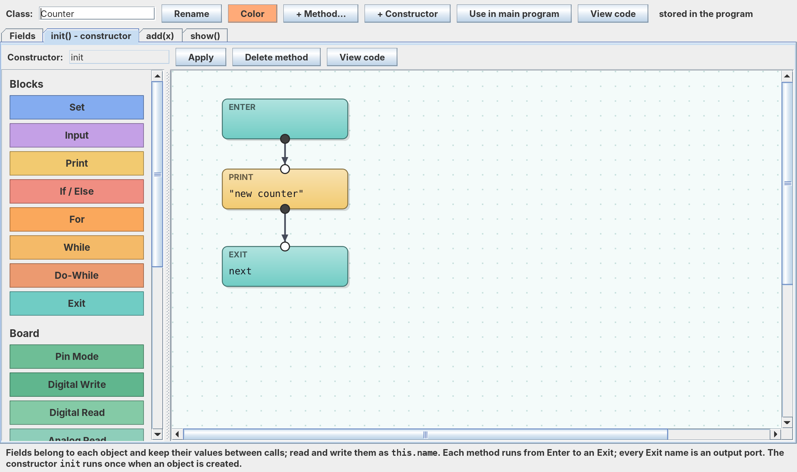

## 4. Klasse verwenden

Die Palette enthält nun `Counter.add(x)` und `Counter.show()`. Ziehe `Counter.add(x)` nach **Print** in den Schleifenkörper und `Counter.show()` zwischen `done` und **End**. Mit einem Doppelklick auf einen Aufrufblock kannst du Methode, **Objekt** und Argumente auswählen. Verwende für beide Blöcke den Objektnamen `c`, damit sie dasselbe Objekt nutzen.

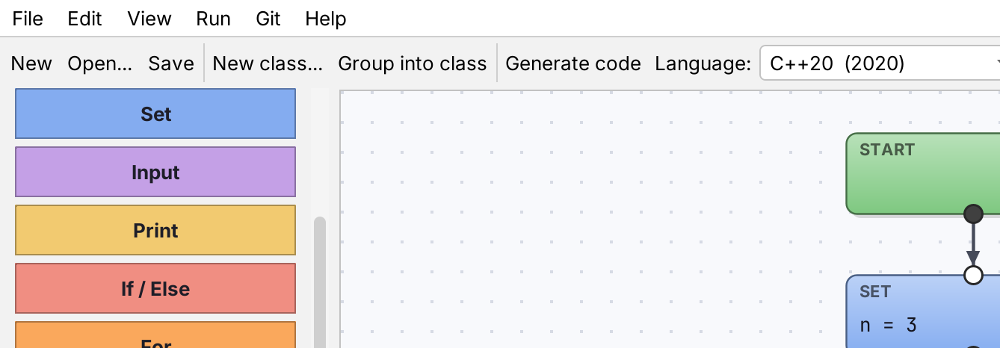

Führe das Programm aus. `c` wird bei der ersten Verwendung erzeugt (dabei erscheint `new counter`), `add` wird dreimal aufgerufen und `show` gibt die Summe aus.

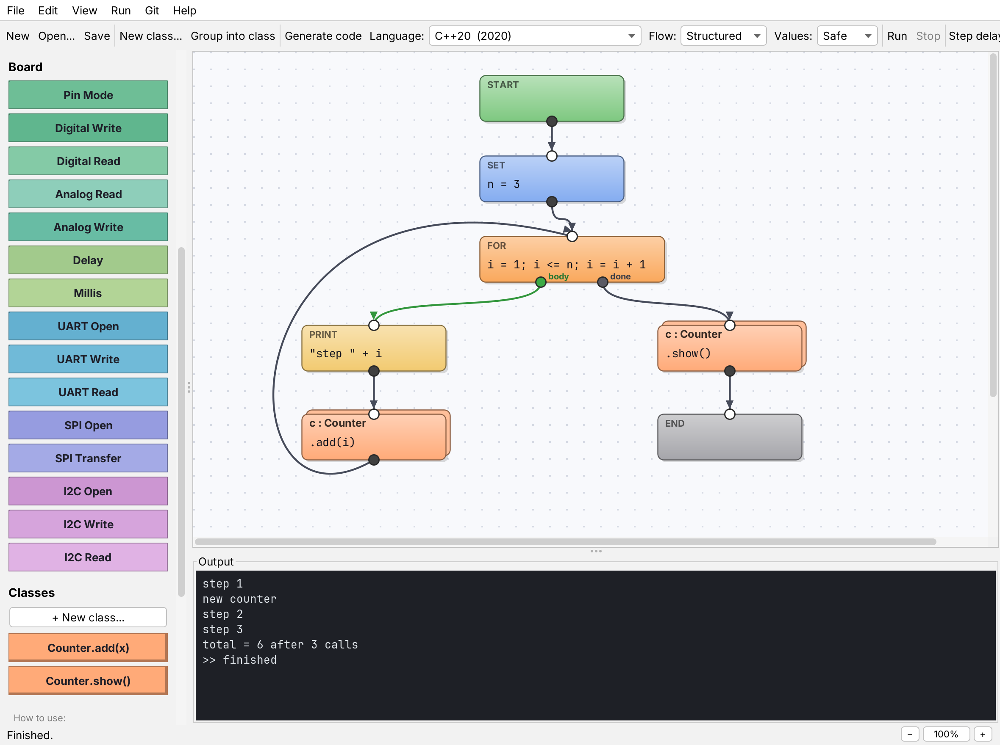

## 5. Code eines Blocks ansehen

Klicke mit der rechten Maustaste auf einen Block und wähle **View source code**. Der erzeugte Code wird geöffnet; die Zeilen dieses Blocks sind hervorgehoben. Hier ist C++20 als Standardsprache ausgewählt.

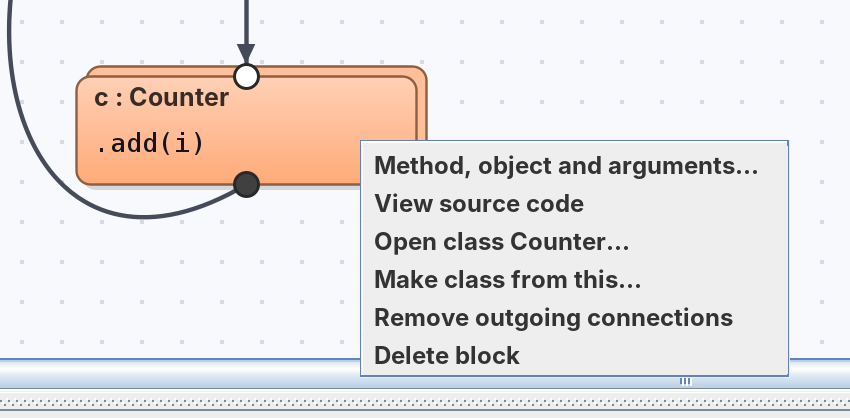

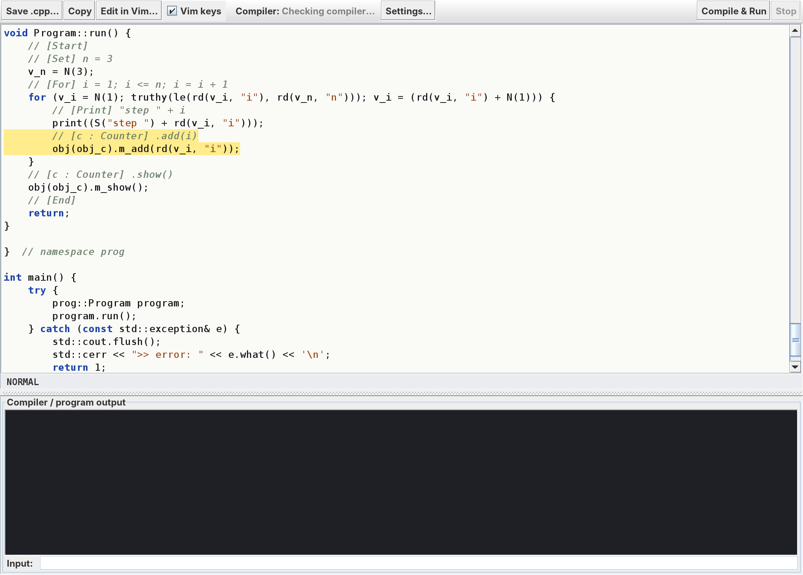

**Compile & Run** kompiliert den Code mit Clang oder GCC und führt ihn aus. Das kompilierte Programm gibt dasselbe aus wie der Interpreter. Unter Windows installiert die Anwendung llvm-mingw (Clang) oder WinLibs (GCC); Visual Studio ist nicht erforderlich.

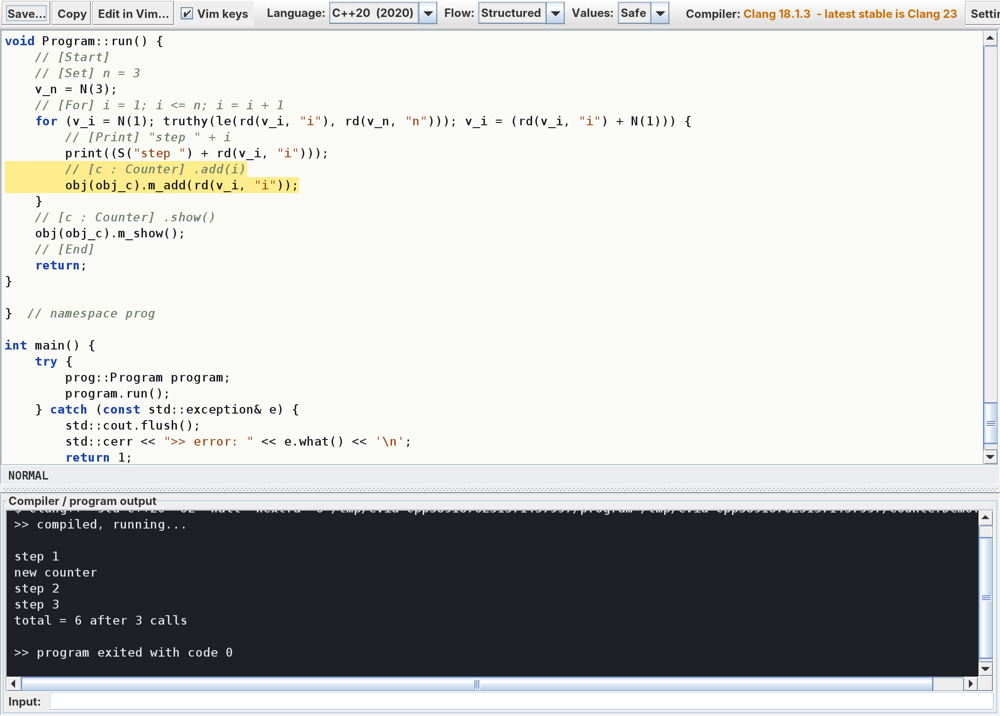

## 6. C oder einen C++-Standard wählen

Wähle **Language** in der Auswahlliste des Codefensters oder der Hauptsymbolleiste. Der Code wird sofort neu erzeugt und derselbe Block bleibt hervorgehoben. **Flow** und **Values** bestimmen den Stil: **Structured** verwendet if/else, Schleifen und switch; **Goto** macht aus jedem Block ein Label und aus jeder Verbindung einen Sprung. **Safe** behält Text und Interpreter-Prüfungen bei; **Fast** verwendet einfache `double`-Werte ohne Laufzeitprüfungen.

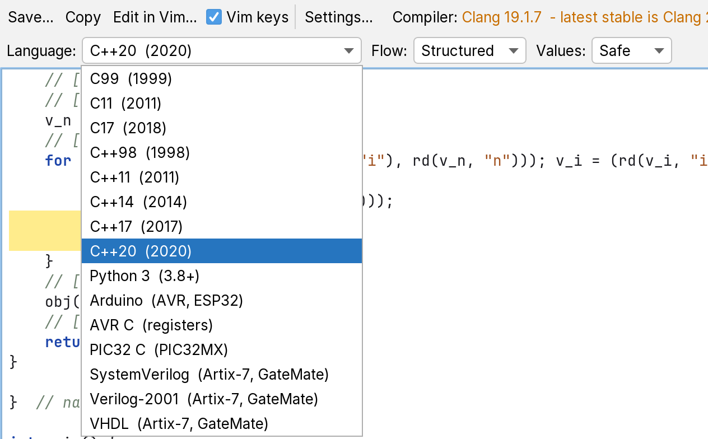

Dasselbe Programm in **C11**, kompiliert mit `clang -std=c11`: Die Ausgabe ist identisch.

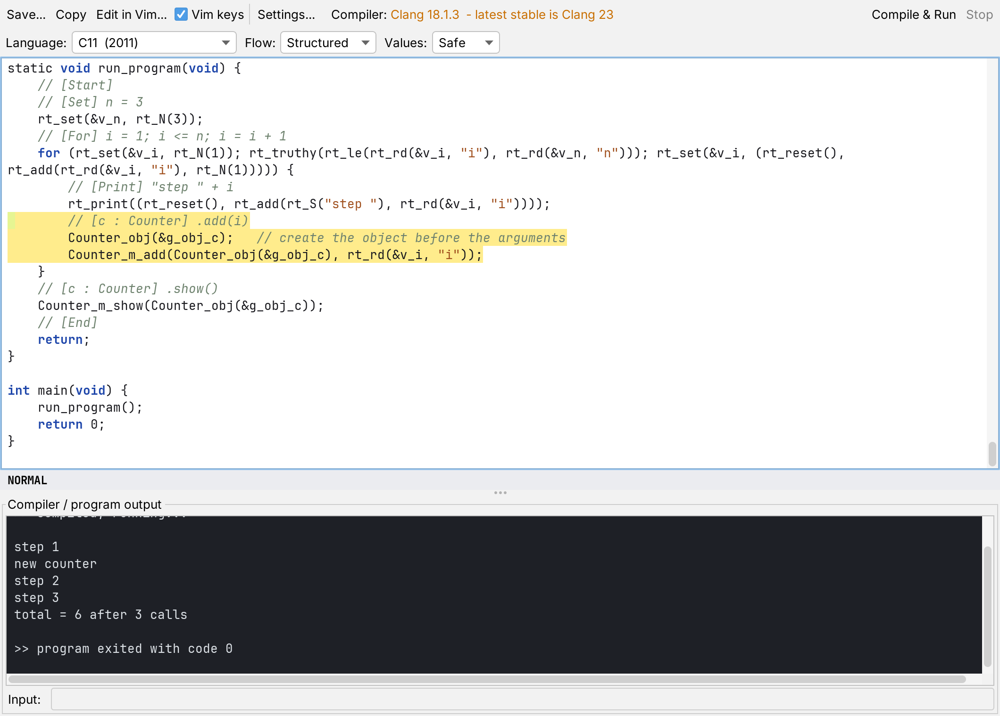

**C++17** mit dem Ablauf **Goto** und den Werten **Fast**:

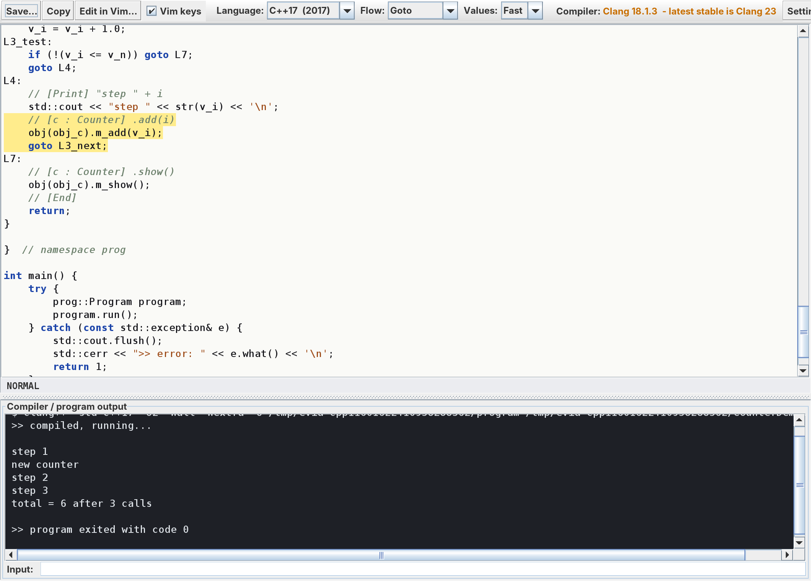

## 7. Änderungen committen und auf GitHub veröffentlichen

**Git → Commit…** (Ctrl+K) speichert und committet alle Änderungen. Im Nachrichtenfeld gelten Vim-Tasten (`Esc`, dann `:w` zum Committen).

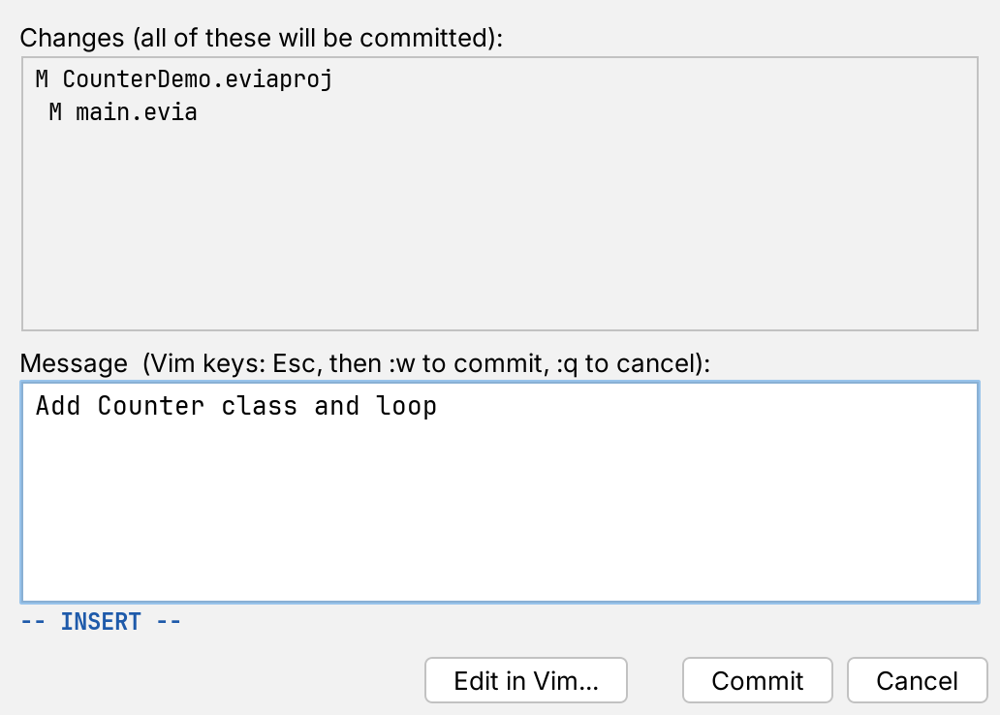

Wähle **Git → Connect to GitHub…** und gib `owner/repo` ein. *Create repository on GitHub…* öffnet github.com mit dem vorausgefüllten Namen. Erstelle dort ein **leeres** Repository, drücke **OK** und das Projekt wird übertragen. Git verwendet die Anmeldedaten, die auf deinem Computer bereits eingerichtet sind (Git Credential Manager, SSH-Schlüssel oder `gh auth login`).

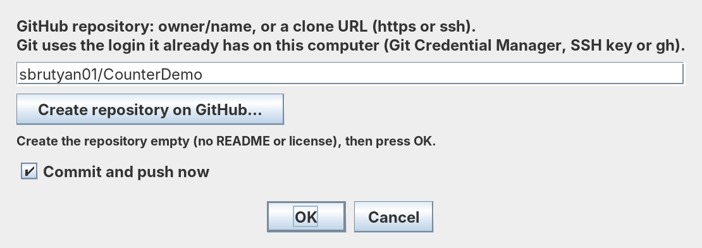

**Git → History** zeigt die Commits:

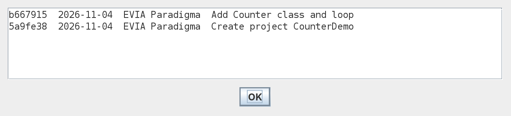

## 8. Arduino- oder ESP32-Board programmieren

Öffne **File → Open Example → Arduino Boards → Blink the built-in LED**. Die grünen **Board**-Blöcke in der Palettengruppe *Board* konfigurieren Pins, lesen Tasten und Sensoren aus und warten. **Run** (F5) simuliert ein Arduino Uno; die Ausgabe zeigt jede Pinänderung samt Zeitpunkt.

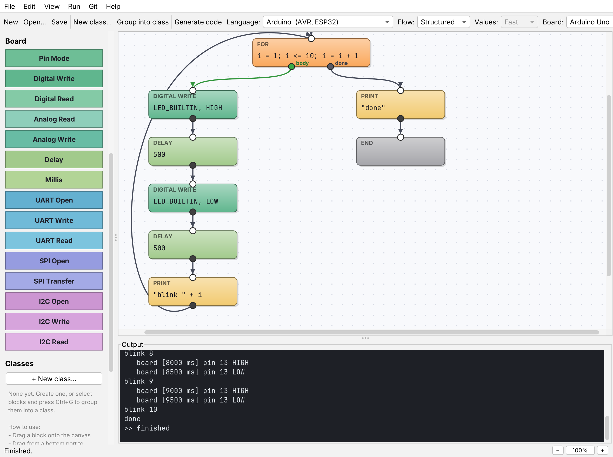

Wähle **Language: Arduino** und ein **Board**, dann **Generate code** (F7): Ein Sketch funktioniert für eines der 12 Boards. **Build** kompiliert ihn mit arduino-cli, **Upload** überträgt ihn auf das Board. Print und Input nutzen den Serial Monitor mit 115200 Baud. **AVR C** erzeugt dasselbe Programm ohne Arduino-Core direkt über die Register des Chips und kompiliert es mit avr-gcc.

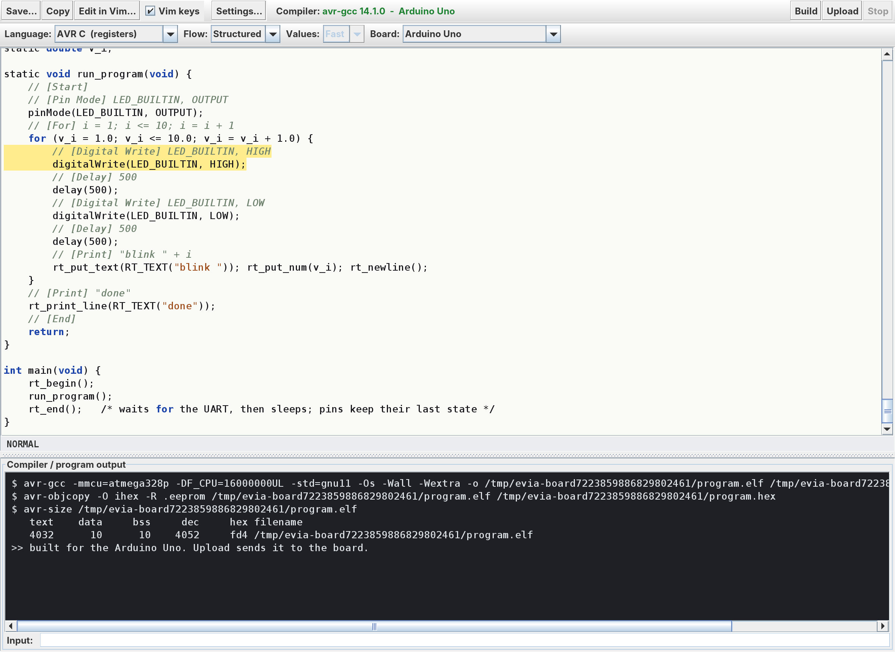

## 9. Mit anderen Chips kommunizieren: UART, SPI, I2C und PIC32

Drei weitere Beispiele unter **File → Open Example → Arduino Boards** verwenden Busblöcke: *UART: send a byte, read it back*, *SPI: transfer a byte* und *I2C: write and read a device register*. Öffne einen Bus, bevor du ihn verwendest. **Run** simuliert UART als Loopback, verbindet den SPI-Eingang mit dem Ausgang und stellt ein I2C-Gerät mit 256 Registern an Adresse 80 bereit (80 ist 0x50; Zahlen sind dezimal).

| Block | Code | Funktion |
|---|---|---|
| **UART Open** | `9600` | Startet den seriellen Port mit dieser Baudrate |
| **UART Write** | `65` | Sendet ein Byte (0..255) |
| **UART Read** | `c` | Nächstes empfangenes Byte oder -1, falls keines vorliegt |
| **SPI Open** | `1000000` | SPI-Master mit dieser Taktfrequenz in Hz (Modus 0, MSB zuerst) |
| **SPI Transfer** | `reply = 66` | Sendet ein Byte und speichert das gleichzeitig empfangene Byte |
| **I2C Open** | `100000` | I2C-Master mit dieser Taktfrequenz in Hz |
| **I2C Write** | `80, 0, 42` | Adresse (7 Bit), Register, Wert |
| **I2C Read** | `v = 80, 0` | Speichert den Registerwert oder -1, wenn kein Gerät antwortet |

Für einen Microchip-PIC32MX-Chip wählst du **Language: PIC32 C** und den Chip in der Liste **Board** (neun Chips aus den Familien MX1xx/2xx, MX3xx/4xx und MX5xx/6xx/7xx) und drückst **Generate code** (F7). Das Ergebnis ist Bare-Metal-C für den kostenlosen Microchip-XC32-Compiler. Takt, Pins, PWM, ADC, UART, SPI und I2C werden über Register konfiguriert. **Build** ruft `xc32-gcc` und `xc32-bin2hex` auf; **Upload** verwendet den unter **Settings** festgelegten Befehl (standardmäßig `pic32prog {hex}`). Die Pins der Chipfamilie stehen am Anfang der generierten Datei.

*Hinweis:* Der PIC32-Code wurde anhand echter Microchip-Geräteheader geprüft, aber noch nicht mit XC32 kompiliert oder auf einem Chip ausgeführt. Betrachte den ersten Build auf deinem Board als Test.

## 10. Hardware für ein FPGA erstellen

Wähle **Language: SystemVerilog**, **Verilog-2001** oder **VHDL** und danach unter **Board** ein Digilent Nexys A7-100T, Arty A7-35 oder A7-100, Basys 3 (Artix-7), Olimex GateMateA1-EVB oder Cologne Chip GateMate A1 evaluation board. Öffne **File → Open Example → FPGA Boards → Blink** und drücke **Generate code** (F7).

Jeder Block wird zu einem Zustand einer Zustandsmaschine und benötigt einen Taktzyklus. Pins sind beim Erstellen des Designs festgelegt; verwende deshalb Namen wie `LED0`, `SW3`, `BTNC` und `JA1`. Der erste Kommentar der Datei enthält die Pinbelegung. Mit `-o` auf der Befehlszeile werden sie zusätzlich als `.xdc` (Vivado) oder `.ccf` (GateMate) gespeichert.

- **Build** und **Upload** verwenden Vivado oder den Open-Source-Werkzeugfluss für Artix-7 (Auswahl unter **Settings**); für GateMate kommen yosys, nextpnr-himbaechel, gmpack und openFPGALoader zum Einsatz.
- Zahlen sind vorzeichenbehaftete 32-Bit-Ganzzahlen: `5 / 2` ergibt auf dem FPGA 2, bei **Run** dagegen 2,5.
- Klassen, Input, Analog Read, SPI, I2C und Text in Variablen werden noch nicht unterstützt; die Fehlermeldung nennt den betreffenden Block.

*Hinweis:* Die Ausgabe wurde mit Open-Source-Werkzeugen simuliert und synthetisiert, aber nicht mit Vivado verarbeitet oder auf ein Board geladen.

## 11. Zahlen per MQTT weiterschicken

Öffne **Datei → Beispiel öffnen → ESP32 Boards → MQTT sensor**. Das Programm veröffentlicht eine
Temperatur bei einem Broker, schickt sich selbst einen Befehl und liest ihn zurück.

Die fünf **MQTT**-Blöcke stehen in der Gruppe *Board*: *MQTT Connect*, *MQTT Publish*, *MQTT Subscribe*,
*MQTT Has Message* und *MQTT Read*. Netzwerkname, Passwort, Broker und Themen sind feste Texte, denn sie werden beim
Erzeugen in das Programm geschrieben.

- **Run** antwortet aus einem Broker auf deinem Rechner, das Programm lässt sich also ohne Hardware ausprobieren.
- **PIC32 C** steuert ein ESP8266- oder ESP32-Modul mit AT-Firmware über UART2, Print behält UART1.
- **Arduino** auf einem **ESP32**-Board nutzt das WLAN des Boards selbst.
- Ein AVR-Board lehnt die Blöcke ab: Es hat eine serielle Schnittstelle, und die benutzt Print.

Eine Nachricht ist eine Zahl. *MQTT Read* liefert -1, wenn nichts angekommen ist; frage also vorher
*MQTT Has Message*, falls eine echte -1 vorkommen kann.

*Hinweis:* Die MQTT-Pakete werden in der CI gegen einen echten Broker geprüft, aber weder ein WLAN-Modul noch ein
ESP32 oder ein PIC32-Chip waren dabei. MQTT über den Ethernet-Anschluss der MX695/795-Chips gibt es noch nicht.

## 12. Weiter geht's

- Verwende Klassen in mehreren Programmen: **File → Export Classes as Module…**, danach **File → Import Module…** im anderen Programm.
- **File → Open Example** enthält fertige Programme, darunter `classes.evia` mit Feldern, Konstruktor, Methoden und Modul.
- **Help → Tutorial (PDF)** öffnet dieses Tutorial in Englisch, Russisch, Armenisch, Deutsch, vereinfachtem Chinesisch, traditionellem Chinesisch oder Japanisch.
- **Help → Guide** (F1) erklärt alle Blöcke, Ausdrücke, Klassen, Projekte, Git, Tastenkürzel und Vim-Tasten auf Englisch, Russisch oder Armenisch. Mit **View → Theme** wechselst du zwischen hellem und dunklem Design.

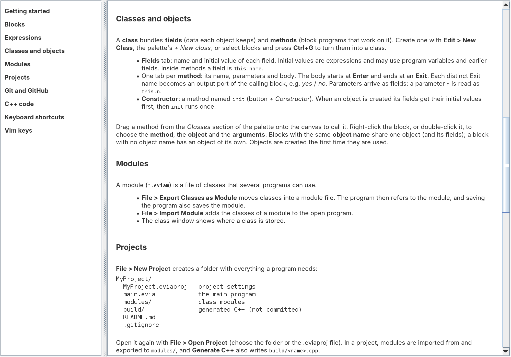

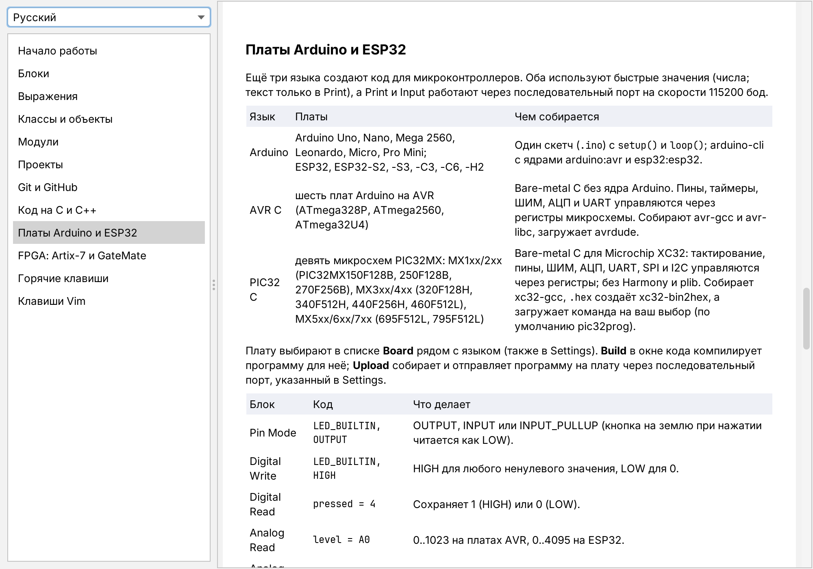 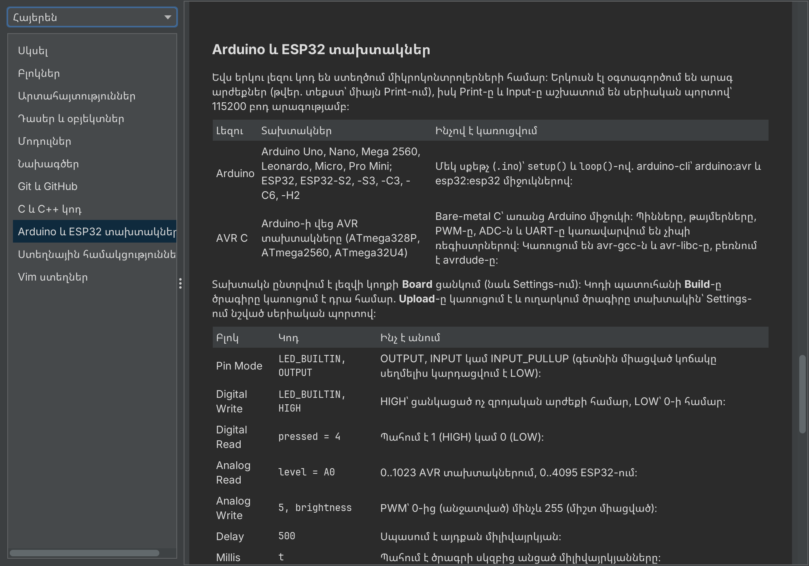

